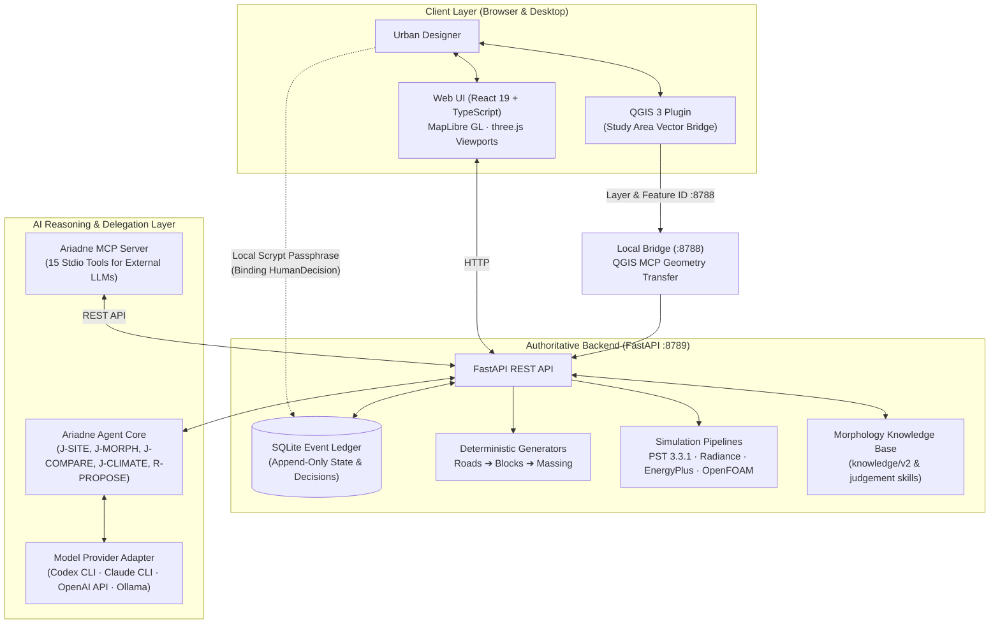

# Ariadne

> **A contestable AI design partner for early-stage urban design.**  
> *Built by Yu Cheng Hsieh for IDEM307 Generative AI and Design, TU Delft (2026–27).*  
> [繁體中文說明 (Traditional Chinese)](README.zh-TW.md)

[](LICENSE)
[](pyproject.toml)
[](web/package.json)
[](#testing)

[](docs/media/screenshots/compare-en.png)

[▶ Watch the 3-minute demo](docs/media/ariadne-demo.mp4)

---

## Why Ariadne?

Early-stage urban design decisions set building envelopes, street networks, public corridors, and microclimate performance for decades. Yet designers exploring options face three systemic dilemmas:

1. **Consequential early choices under high uncertainty**: Road layouts and massing configurations locked in during Week 1 dictate daylight, wind, and mobility for the project lifetime.
2. **Chat-based LLMs sound certain without verifiable sources**: Generative models readily hallucinate floor area ratios, claim non-existent solar compliance, or suggest geometry without topological validity.
3. **Simulation feedback is slow and difficult to challenge**: Microclimate and syntax calculations either arrive too late to inform massing or live in black-box consulting reports that cannot be iteratively critiqued.

Ariadne re-imagines the AI as a **contestable co-designer**. The AI does not generate final plans or rubber-stamp approvals. Instead, it reads deterministic simulation evidence, formulates structured architectural judgements, states its reasoning and limitations, and invites the designer to agree, contest, or request parametric revisions.

---

## Core Principle

From [`AGENTS.md`](AGENTS.md):

> **LLMs reason. Deterministic tools calculate. Validators verify. Humans decide.**

- **The AI never approves**: Binding milestones (boundary adoption, constraint activation, scheme adoption, proposal merge) are strictly recorded as immutable `HumanDecision` events confirmed by the designer via a local cryptographic passphrase.
- **Zero credential leaks**: No API keys or passwords are stored in repository files, ledger records, or frontend state. Keys are retrieved dynamically from the macOS Keychain or executed via local CLI subprocesses.
- **Honest metrics**: Space syntax scores denote topological potential, not pedestrian traffic volume. Simulation results are exploratory screening evidence, never regulatory certifications.

---

## What Ariadne Does (5-Stage Design Workflow)

The workflow is site-agnostic in design (draw a study area in QGIS), but this snapshot ships configuration and verified source packages only for Rotterdam M4H; another site needs its own prepared source package and anchor configuration.

```
Site  ──▶  Conditions  ──▶  Generate  ──▶  Compare  ──▶  Refine
```

### 1. Site

Draw or import a study area via the companion QGIS 3 plugin or direct vector polygon. The API consumes previously prepared, verified local BAG and OSM data from a source package (drawing an extent does not trigger data acquisition; any 3DBAG height join is a separate, source-backed processing step and is not performed by this runtime loader). Compute baseline context metrics (land-use mix, water proximity, baseline density).

### 2. Conditions

Inspect existing structures, specify retained vs. editable buildings, declare protected industrial heritage (e.g., harbour silos), and review multi-radius Space Syntax context (800 m pedestrian, 2 km cycling, 10 km vehicular) calculated with Place Syntax Tool (PST 3.3.1). Confirm baseline design constraints.

### 3. Generate

Ariadne synthesises design briefs grounded in an urban morphology knowledge base (`knowledge/v2/`). A deterministic parametric engine translates constraints into four spatial schemes:
- **Harbour grain** (*linear dockland piers and quays*)
- **Closed block extension** (*traditional European perimeter blocks*)
- **Courtyard islands** (*porous perimeter clusters with shared courtyards*)
- **Landscape figure** (*freestanding volumes framed by continuous green corridors*)

### 4. Compare

Evaluate the schemes side-by-side in synchronized 2D MapLibre and 3D three.js viewports. Inspect cross-scheme metric scorecards and artifact-backed microclimate results:
- **E1 Solar**: Winter solstice, equinox, and summer solstice ground daylight hours (via dedicated run workflow).
- **UTCI**: Summer peak (14:00) outdoor thermal comfort and heat stress distribution (artifact-backed).
- **E2 Radiation**: Incident facade and ground summer solar radiation ($kWh/m^2$, separate workspace).
- **E3/E4 Energy & Mass**: Building energy use intensity (EUI) and thermal mass buffering (artifact-backed).
- **E5 Wind**: Bundled pedestrian wind comfort screening covering SW, W, S, and NW sectors (coarse-mesh screening).

### 5. Refine

Directly modify schemes with tactile geometric operators: change massing heights in floor-level increments (3.5 m standard, 4 m ground), apply 1 m lateral steps, perform face subdivision and upper-floor setback extrusions, and edit streets with topological snapping. Real-time validators ensure FAR caps and setback limits are not violated.

---

## Ariadne AI: Judgement Cards, Contestability & Dialogue

Ariadne interacts through structured, schema-validated **Judgement Cards** (`knowledge/judgement/judgement-card.schema.json`) produced by specialized skills:
- `J-SITE`: Site constraints, perimeter interfaces, and heritage retention diagnosis.
- `J-MORPH`: Morphology generation readiness, fabric density, and street connectivity.
- `J-COMPARE`: Cross-scheme trade-off evaluation (e.g., density vs. courtyard daylight).
- `J-CLIMATE`: Microclimate screening interpretation across solar, heat, and wind metrics.

```
       ┌────────────────────────┐
       │   Ariadne Judgement    │
       │ (Stance, Evidence Refs)│
       └───────────┬────────────┘
                   │
         Designer reviews card
         ┌─────────┴─────────┐
         ▼                   ▼
    [ Agree ]         [ Contest / Supplement ]
                             │
                             ▼
               [ Request Revision Proposal ]
                             │
                             ▼
               ┌───────────────────────────┐
               │ R-PROPOSE: Parametric Fix │
               │ (Floor cuts, setbacks, …) │
               └─────────────┬─────────────┘
                             │
                 Designer approves dry-run
                             │
                             ▼
               ┌───────────────────────────┐
               │   Deterministic Rerun     │
               │ (E1 Solar / UTCI recast)  │
               └─────────────┬─────────────┘
                             │
                             ▼
               ┌───────────────────────────┐
               │    Ariadne Re-judgement   │
               │   ("Partial response" …)  │
               └───────────────────────────┘
```

The designer can **Agree**, **Contest**, or **Supplement** any card. When challenged, Ariadne invokes `R-PROPOSE` (`proposal.schema.json`) to draft concrete parametric fixes (e.g., `REMOVE_TOP_FLOOR`, `SETBACK_UPPER`, `SOLAR_ENVELOPE`). The platform dry-runs the edit, awaits human confirmation, re-executes simulations, and issues a differential re-judgement. Every exchange is preserved in the **Design Dialogue Timeline**.

Cards and proposals can be displayed in **English** or **Traditional Chinese (zh-TW)**.

---

## How Ariadne Works



> [!NOTE]
> **QGIS Bridge & Platform API**: QGIS sends the selected layer ID and feature ID to the local bridge on `127.0.0.1:8788`; the bridge reads and validates the selected geometry through QGIS MCP. The platform API defaults to `127.0.0.1:8789`, while the QGIS plugin’s upstream API URL defaults to `127.0.0.1:8795`; configure `URBAN_DESIGN_API_BASE_URL` to match the API in use.

---

## The AI's Role — and Its Limits

| Capability / Concern | Implemented in Ariadne | Autonomous AI (Forbidden) |
|---|---|---|
| **GIS & Site Measurements** | Deterministic PDOK BAG, 3DBAG, OSM queries | LLM estimates or generated coordinates |
| **Space Syntax Analysis** | Pinned Place Syntax Tool (PST 3.3.1) adapter | Guessed integration scores or flow claims |
| **Microclimate Evaluation** | Radiance, EnergyPlus & OpenFOAM engines | Imagined lux levels, EUI, or wind fields |
| **Design Generation** | Parametric grammar: road → block → building | Diffusion / black-box pixel hallucination |
| **Design Evaluation** | Structured Judgement Cards with metric references | Ungrounded textual praise or critique |
| **Revision Proposals** | Strict schema operations (`REMOVE_TOP_FLOOR`, etc.) | Direct overwrite of official project state |
| **Binding Design Decisions** | **Human designer only** via local decision passphrase | Automated AI approval or ledger signing |

---

## Quick Start

### Prerequisites
- **macOS** or **Linux** (macOS recommended for native Keychain and QGIS integration)
- **Python 3.12**
- **Node.js**: Use a Node version supported by the full lockfile: `^22.22.2`, `^24.15.0`, or `>=26.0.0`; otherwise adjust the dependency set and verify it.
- *(Optional)* **QGIS 3.34+** for drawing site extents live
- *(Optional)* **Docker Desktop** for OpenFOAM E5 wind screening

### 1. Clone & Set Up Backend

```bash
git clone https://github.com/hycsposad113/ariadne.git
cd ariadne

# Create and activate virtual environment
python3.12 -m venv .venv
source .venv/bin/activate

# Install from a portable lockfile that pins a published package or repository revision.
# Note: The current requirements.lock contains a machine-local path and is not usable from a clean clone.
pip install -r requirements.lock
pip install -e .
```

### 2. Initialize Designer Decision Passphrase

Ariadne requires a private, designer-managed decision passphrase to seal consequential decisions. The passphrase is scrypt-hashed into `~/.config/urban-design/decision-key` (mode `0600`). It is never stored in git:

```bash
python -m urban_design.decision_key init
```

### 3. Start Backend Services

```bash
# Launch the local platform API (defaults to 127.0.0.1:8789)
python scripts/run_workspace_server.py
```

> [!WARNING]
> **API Bootstrap Prerequisite**: The Vite development server can serve the frontend without data packs. The API requires a spatial-r01 source package and matching persisted StudyArea/source records; the bare server command fails from this snapshot. Provide a verified bootstrap procedure or a supported no-source mode before documenting the API quick start.

### 4. Start Web Interface

In a separate terminal:

```bash
cd web
npm install
npm run dev
```

Open your browser to `http://localhost:5173`.

> **About data packs.** The repository contains all code, configuration, the knowledge base and figure-level results, but not the large runtime data packs (morphology preview catalogue, regional space-syntax context, OSM/BAG extracts, intermediate simulation fields — several GB). Without them the UI starts and the judgement, MCP and editing code paths can be inspected, but the M4H demo layers stay empty. The server options `--morphology-preview-root`, `--syntax-context-root`, `--climate-artifact-root` and `--e2-*` point to these packs; the scripts in `scripts/` regenerate them from public sources (BAG, 3DBAG, OSM, KNMI EPW).

---

## Bring Your Own AI

Ariadne supports both in-app provider profiles and external Model Context Protocol (MCP) clients.

### 1. In-App Model Settings


Open the **AI Model Settings** panel in the web interface to select your reasoning engine:
- **Codex CLI**: OpenAI Codex CLI (`codex`) running `gpt-6-luna` with `model_reasoning_effort=max`.
- **Claude CLI**: Anthropic Claude Code CLI (`claude`).
- **OpenAI-Compatible APIs**: Profiles must implement the protocol supported by their configured adapter; the OpenAI-compatible profile requires an OpenAI-compatible endpoint. Store your key safely in macOS Keychain (`urban-design-openai-gpt-4o`). Settings status checks query Keychain item presence without returning the value. Authorized live dispatch reads the key into process memory for the provider request; the key is not exposed in status responses or logs.
- **Local Ollama**: Shipped as a disabled template with no endpoint or model configured; configure and enable it before use for offline inference with zero data egress.

*Weekly Live AI Budget*: Set by default to 200 calls to prevent accidental token overruns.

### 2. External MCP Server (Model Context Protocol)

Connect Ariadne directly to external AI coding environments via stdio using `python -m urban_design.ariadne_mcp`. The server exposes 15 tools spanning site queries, syntax layers, scenario comparisons, and judgement/revision dialogues.

#### Codex CLI (`~/.codex/config.toml` or `./config.toml`)

```toml
[mcp_servers.ariadne]
command = "/path/to/ariadne/.venv/bin/python"
args = ["-m", "urban_design.ariadne_mcp"]
env = { ARIADNE_API_BASE_URL = "http://127.0.0.1:8789" }
```

#### Claude Code CLI

```bash
claude mcp add ariadne --env ARIADNE_API_BASE_URL=http://127.0.0.1:8789 -- /path/to/ariadne/.venv/bin/python -m urban_design.ariadne_mcp
```

#### Claude Desktop (`claude_desktop_config.json`)

```json
{
  "mcpServers": {
    "ariadne": {
      "command": "/path/to/ariadne/.venv/bin/python",
      "args": ["-m", "urban_design.ariadne_mcp"],
      "env": {
        "ARIADNE_API_BASE_URL": "http://127.0.0.1:8789"
      }
    }
  }
}
```

---

## Project Structure

```text
.
├── config/                  # Provider profiles, runtime policies, and PST manifests
├── docs/                    # Architecture records, user guide, evidence dockets
│   ├── media/               # Screenshots and walkthrough demo video
│   ├── architecture.md      # Detailed subsystem architecture & sequence flows
│   ├── ai-integration.md    # Judgement skills, prompts, schema & MCP specifications
│   └── user-guide.md        # Complete 5-stage walk-through tutorial
├── knowledge/               # Morphological curriculum and design judgement skills
│   ├── judgement/           # J-SITE, J-MORPH, J-COMPARE, J-CLIMATE, R-PROPOSE & schemas
│   └── v2/                  # Urban fabric knowledge units & domain rules
├── qgis_plugin/             # Urban Design Study Area plugin for QGIS 3
├── scripts/                 # Deterministic simulation pipelines (E1–E5, UTCI, PST)
├── src/urban_design/        # Core FastAPI backend, store ledger, geometric generators
│   ├── ariadne_mcp/         # Stdio Model Context Protocol server (15 tools)
│   ├── environment/         # Climate & simulation routing adapters
│   ├── generation/          # Road network, block subdivision & massing generators
│   └── judgement/           # Judgement & revision proposal execution engine
├── tests/                   # Pytest backend & integration tests
└── web/                     # React 19 + TypeScript + MapLibre + three.js frontend
```

---

## Testing

Ariadne enforces strict automated testing across Python backend logic and TypeScript web interfaces.

```bash
# Run backend pytest suite
PYTHONPATH=src pytest -q

# Run web test suite
npm --prefix web run test

# Validate web build & linting
npm --prefix web run build
npm --prefix web run lint
```

The latest full test run and its results are recorded in [docs/test-report.md](docs/test-report.md).

---

## Data Sources & Attributions

- **PDOK BAG (Basisregistratie Adressen en Gebouwen)**: Dutch national building and address registry, see source's licence (published under CC0 1.0 Universal).
- **OpenStreetMap**: Street networks and land-use context, © OpenStreetMap contributors, see source's licence (Open Database License, ODbL).
- **3DBAG**: 3D building models developed by the 3D Geoinformation Group at TU Delft, see source's licence (CC-BY 4.0).
- **KNMI Weather Data**: EPW weather files derived from Royal Netherlands Meteorological Institute observations, see source's licence.

*Repository note*: Massive spatial caches and raw OpenFOAM volume grids are excluded from git history. Pre-computed benchmark figures are bundled under `artifacts/w8/`. Certain internal analysis logs retain local development paths (`/Users/jackhsieh/...`), documented transparently in historical dockets.

---

## Limitations & Disclaimers

1. **Exploratory screening, not compliance certification**: E1 solar hours, UTCI heat stress, and EnergyPlus EUI metrics provide comparative design feedback. They are not legal certifications or construction documents.
2. **Coarse CFD mesh (E5 Wind)**: OpenFOAM runs use a coarse domain mesh suitable for desktop screening. Wind wake details behind complex porous facades should be verified with fine-scale boundary-layer wind tunnel or high-order CFD simulations.
3. **Space Syntax is topological potential**: High angular integration (NAIN) indicates structural accessibility within the street graph, not guaranteed footfall or retail viability.
4. **Single-user local environment**: Ariadne is designed as a focused, local desktop design environment, not a multi-tenant cloud SaaS.

---

## Roadmap

- [x] QGIS 3 live vector extent synchronisation and Dutch BAG/OSM ingestion.
- [x] Multi-fabric deterministic generation (Harbour, Closed Block, Courtyard, Landscape).
- [x] Pinned Place Syntax Tool (PST 3.3.1) integration across walk/bike/car networks.
- [x] Microclimate simulation suite (E1 Solar, UTCI Heat, E2 Radiation, E3/E4 Energy, E5 Wind).
- [x] Schema-validated Judgement Cards (`J-SITE`, `J-MORPH`, `J-COMPARE`, `J-CLIMATE`).
- [x] Contestability loop with `R-PROPOSE` parametric revision proposals.
- [x] Stdio MCP Server with 15 tools for external coding agents.
- [ ] Export to standard IFC 4.3 architectural models and CityGML 3.0.
- [ ] Multi-scenario pareto frontier explorer across conflicting microclimate metrics.

---

## Acknowledgements

Ariadne was developed as part of **IDEM307 Generative AI and Design** (2026–27) at **Delft University of Technology (TU Delft)**.

Special thanks to the open-source projects that form Ariadne's foundation: [FastAPI](https://fastapi.tiangolo.com/), [MapLibre GL](https://maplibre.org/), [three.js](https://threejs.org/), [Place Syntax Tool (PST)](https://github.com/SMoG-Chalmers/PST), [Radiance](https://www.radiance-online.org/), [EnergyPlus](https://energyplus.net/), and [OpenFOAM](https://openfoam.com/).

---

## Citation

If you reference Ariadne in your research or design work, please cite:

```bibtex
@software{hsieh2026ariadne,
  author = {Hsieh, Yu Cheng},
  title = {Ariadne: A Contestable AI Design Partner for Early-Stage Urban Design},
  year = {2026},
  url = {https://github.com/hycsposad113/ariadne},
  institution = {Delft University of Technology (TU Delft)}
}
```

See [`CITATION.cff`](CITATION.cff) for complete citation metadata.

---

## License

Code is licensed under the [MIT License](LICENSE) © 2026 Yu Cheng Hsieh.  
Third-party datasets, libraries, and weather profiles remain under their respective licenses.
