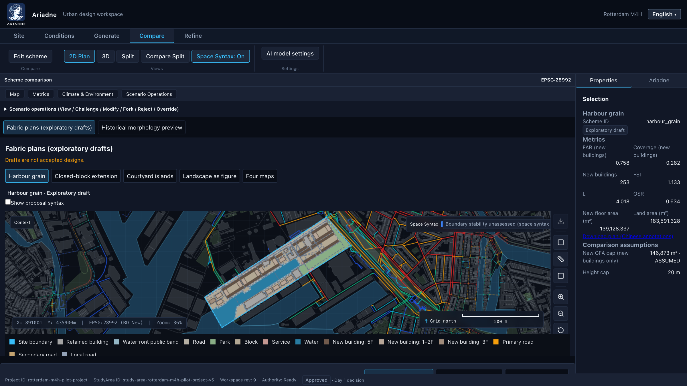
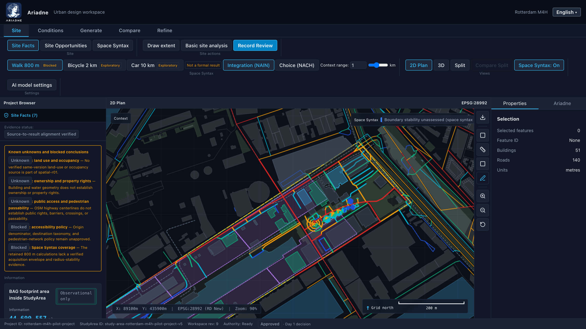
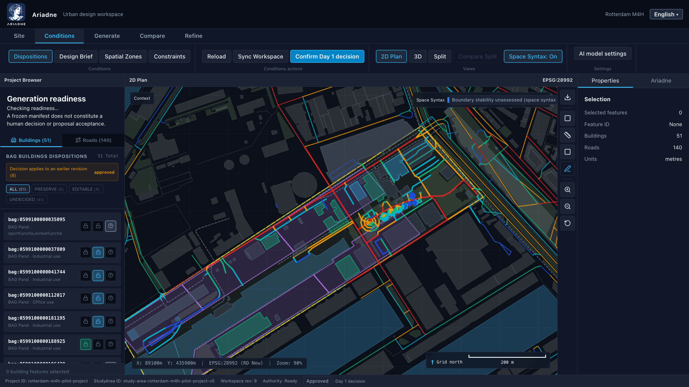
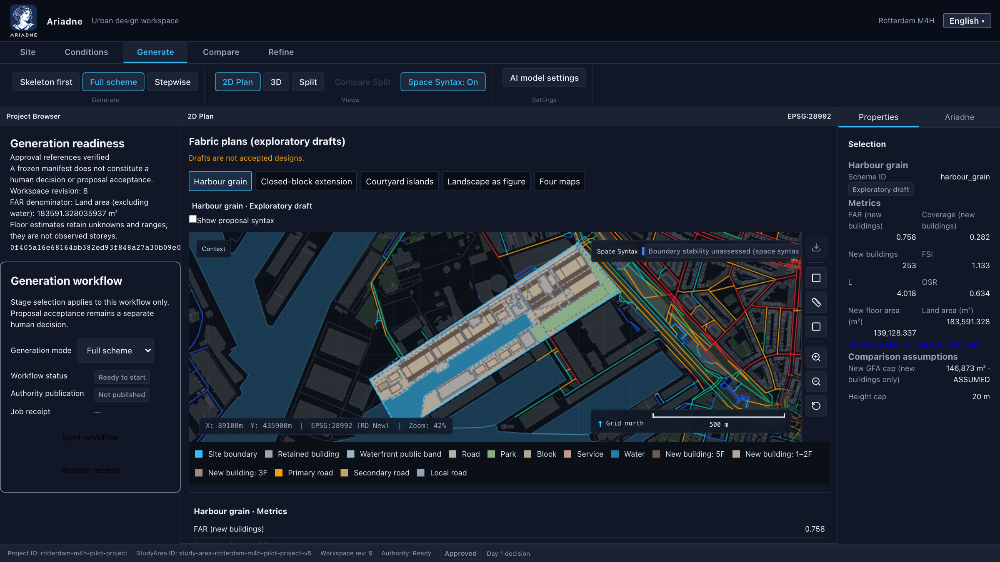
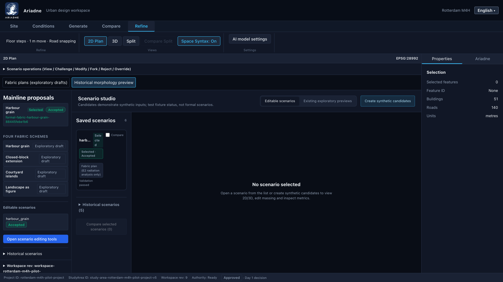
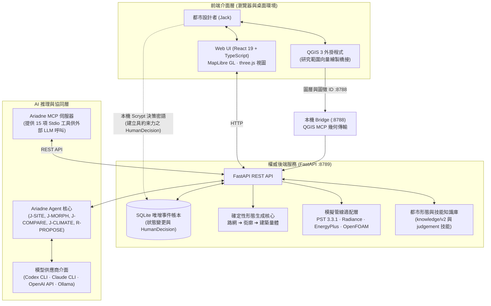
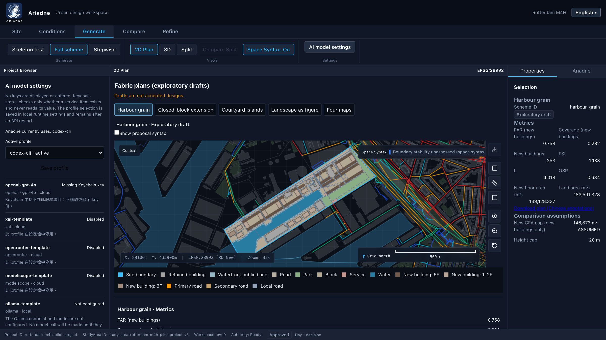

# Ariadne

> **具可質疑性的前期都市設計 AI 協同夥伴**  
> *由 謝育承（Yu Cheng (Jack) Hsieh）建構於荷蘭台夫特理工大學（TU Delft）2026–27 學年度 IDEM307 生成式 AI 與設計課程。*  
> [English Documentation](README.md)

[](LICENSE)
[](pyproject.toml)
[](web/package.json)
[](#測試)

[](docs/media/screenshots/compare-en.png)

[▶ 觀看 3 分鐘展示影片](docs/media/ariadne-demo.mp4)

---

## 為什麼需要 Ariadne？

在都市設計的前期探索階段，各項幾何配置決策（路網結構、街廓形式、量體高度、公共開放空間）將深刻影響基地未來數十年的微氣候與空間活力。然而，當前設計者在整合數位工具時常面臨三大困境：

1. **早期決策具深遠影響卻伴隨高不確定性**：第 1 週決定的路網與建築邊界，直接鎖定了往後的日照、風場、步行通達性與土地使用潛力。
2. **對話式語言模型「自信滿滿卻缺乏源頭依據」**：傳統生成式模型極易虛構容積率（FAR）、捏造法規日照合規結論，或生成缺乏拓撲連續性的破碎幾何。
3. **專業模擬回饋遲緩且難以直觀辯證**：微氣候與空間語法分析往往耗時冗長，或被封閉於顧問專屬的黑盒報告中，無法在前期設計反覆迭代中被有效檢視與挑戰。

Ariadne 重新將 AI 定位為**「可被質疑的協同設計夥伴（Contestable Design Partner）」**。AI 不直接產出無法修改的定案，也不代行任何核准程序。相反地，它讀取確定性專業工具計算的真實數據，產出具備明確證據參照、推理脈絡與局限說明的結構化「判讀卡」，並邀請設計者在互動流程中表達同意、質疑或要求參數化修正。

---

## 核心原則

源自專案憲章 [`AGENTS.md`](AGENTS.md)：

> **大型語言模型負責推理。確定性工具負責計算。驗證器負責核實。人類設計者擁有最終決策權。**  
> *(LLMs reason. Deterministic tools calculate. Validators verify. Humans decide.)*

- **AI 絕不代行核准**：所有具法律效力或架構約束的決策（基地邊界採納、約束條件啟用、量體方案正式接受、修正提案套用），一律以不可竄改的 `HumanDecision` 事件紀錄於 SQLite 帳本中，且必須由設計者於使用者介面輸入本機密鑰密語確認。
- **零金鑰外洩原則**：儲存庫程式碼、帳本事件與前端狀態中嚴禁包含任何 API 金鑰或密碼。雲端模型金鑰一律存放於 macOS 系統鑰匙圈（Keychain），本機 CLI 模式則透過子程序執行。
- **實事求是的指標邊界**：空間語法測度僅反映路網拓撲結構的潛在可達性，絕不等於實測人流或交通量；所有微氣候模擬均屬探索性初步篩選，絕非工程認證或法定審查報告。

---

## 五大設計工作流程 (5-Stage Workflow)

本工作流程在設計上具備基地無關性（site-agnostic，可於 QGIS 中繪製研究範圍），但本快照僅隨附鹿特丹 M4H 之設定與經驗證來源套件；若要用於其他基地，需準備專屬的來源套件與錨點設定。

```
Site (基地)  ──▶  Conditions (條件)  ──▶  Generate (生成)  ──▶  Compare (比對)  ──▶  Refine (微調)
```

### 1. Site（基地理解與範疇）

透過專屬 QGIS 3 外掛程式或直接向量導入繪製研究範圍（Study Area）。平台 API 讀取來自來源套件預先準備且經驗證的本機 BAG 與 OSM 圖資（繪製範圍本身不會觸發線上圖資擷取；任何 3DBAG 高度結合屬於獨立的來源處理步驟，不由此執行期載入器執行）。系統自動計算基地混合度、臨水可達性與現況容積密度。

### 2. Conditions（約束與現況條件）

檢視現有建築圖徵，標註保留建築（如工業筒倉與歷史遺產）與可變動量體；透過瑞典 Chalmers 大學 Place Syntax Tool (PST 3.3.1) 運算基地周邊多半徑空間語法環境（800 m 步行、2 km 自行車、10 km 車行），建立正式設計邊界與上限約束。

### 3. Generate（形態生成）

Ariadne 根據都市形態知識庫（`knowledge/v2/`）為不同紋理策略起草設計意圖。底層確定性參數引擎依據「路網結構 → 街廓劃分 → 建築原型」產出四種形態方案：
- **港埠線性紋理 (Harbour grain)**：順應碼頭水岸的長向線性街廓。
- **封閉街廓延伸 (Closed block extension)**：延續歐陸傳統的高密度周邊圍合街廓。
- **中庭群島 (Courtyard islands)**：多孔隙的多核心中庭院落聚落。
- **地景為圖 (Landscape figure)**：被連續生態綠廊環抱的開敞式量體。

### 4. Compare（跨方案多維評估與模擬）

在同步的 2D MapLibre 與 3D three.js 視圖中並列比對四方案。查閱空間量體平衡表，並檢視以工件（artifacts）為基礎之微氣候成果：
- **E1 日照**：冬至、春分與夏至地表直接日照時數分佈（透過專屬執行流程運算）。
- **UTCI 熱壓力**：盛夏最熱日 14:00 戶外通用熱氣候指數（UTCI）與舒適度分級（工件呈現）。
- **E2 輻射**：建築立面與地面夏季累積入射太陽輻射量（$kWh/m^2$，具獨立工作區）。
- **E3/E4 建築耗能與熱質**：整體耗能強度（EUI）與重型熱質材料防過熱成效（工件呈現）。
- **E5 行人風場篩選**：隨附之行人風場篩選涵蓋西南 (SW)、西 (W)、南 (S) 與西北 (NW) 四個風向（粗網格篩選工件）。

### 5. Refine（量體微調與路網編輯）

以直接幾何算子編輯方案量體：樓層級高度調整（挑高首層 4 m、標準層 3.5 m）、1 m 側向移動步長、面分割與高樓層退台拉伸；路網拖曳與拓撲自動吸附。系統即時驗證整體 FAR 上限、棟距與親水退縮規範。

---

## Ariadne AI：判讀卡、質疑機制與設計對話

Ariadne 透過嚴格 Schema 驗證的**判讀卡（Judgement Cards）**（`knowledge/judgement/judgement-card.schema.json`）參與對話，背後由專屬專業技能驅動：
- `J-SITE`：基地現況邊界、周邊界面與工業遺產保留評估。
- `J-MORPH`：形態生成就緒度、紋理密度與路網連通度審視。
- `J-COMPARE`：方案間權衡取捨（如高密度 vs. 中庭冬至日照之衝突）。
- `J-CLIMATE`：跨日照、高溫與風環境模擬數據之綜合解讀。

```
       ┌────────────────────────┐
       │   Ariadne 判讀卡       │
       │ (明確立場、數據證據參照) │
       └───────────┬────────────┘
                   │
           設計者檢視判讀內容
         ┌─────────┴─────────┐
         ▼                   ▼
     [ 同意 ]          [ 質疑 / 補充 ]
                             │
                             ▼
                    [ 請求修正提案 ]
                             │
                             ▼
               ┌───────────────────────────┐
               │ R-PROPOSE：參數化修正提案 │
               │ (降層、退台、日照包絡面)  │
               └─────────────┬─────────────┘
                             │
                     設計者核准乾跑
                             │
                             ▼
               ┌───────────────────────────┐
               │    確定性模組重新計算     │
               │ (重跑 E1 日照 / UTCI)     │
               └─────────────┬─────────────┘
                             │
                             ▼
               ┌───────────────────────────┐
               │      Ariadne 重新判讀     │
               │  (針對成效發布部分回應卡) │
               └───────────────────────────┘
```

設計者可對任何判讀卡選擇**「同意（Agree）」**、**「質疑（Contest）」**或**「補充意見（Supplement）」**。若設計者提出質疑，Ariadne 會調用 `R-PROPOSE`（`proposal.schema.json`）產出具體可執行的參數化修正動作（如 `REMOVE_TOP_FLOOR` 降層、`SETBACK_UPPER` 退台、`SOLAR_ENVELOPE` 中庭日照包絡線重構）。系統執行乾跑預覽，經設計者確認後由確定性模組重算模擬，Ariadne 再發布下一輪增量判讀。所有歷程均完整保存在**設計對話時間軸（Design Dialogue Timeline）**中。

卡片與提案支援繁體中文（zh-TW）與英文（en）即時切換。

---

## 系統架構



> [!NOTE]
> **QGIS Bridge 與平台 API 邊界**：QGIS 將選取的圖層 ID 與圖徵 ID 發送至本機 bridge（`127.0.0.1:8788`）；bridge 透過 QGIS MCP 讀取並驗證選取的幾何圖形。平台 API 預設為 `127.0.0.1:8789`，而 QGIS 外掛預設的上游 API URL 為 `127.0.0.1:8795`；請設定 `URBAN_DESIGN_API_BASE_URL` 以符合使用中的 API。

---

## AI 的角色與不可踰越的邊界

| 功能範疇 | Ariadne 平台之實作方式 | 自主型 AI（嚴格禁止） |
|---|---|---|
| **GIS 與基地量測** | 確定性查詢 PDOK BAG、3DBAG 與 OSM 圖資 | 由大型模型自力估算或捏造座標 |
| **空間語法分析** | 鎖定版本之 Place Syntax Tool (PST 3.3.1) 算子 | 模型揣測之整合度或任意人流保證 |
| **微氣候模擬** | Radiance、EnergyPlus 與 OpenFOAM 引擎精準計算 | 模型想像之光照度、EUI 耗能或風速 |
| **空間方案生成** | 參數化形態文法：路網 → 街廓 → 量體原型 | 擴散模型生成之無拓撲像素或點雲假象 |
| **方案設計評估** | 引用具體驗證指標的結構化判讀卡 | 無依據的文字空泛稱讚或片面批評 |
| **修正提案產出** | 嚴格運算元（`REMOVE_TOP_FLOOR`、`SOLAR_ENVELOPE` 等） | 直接竄改或覆寫正式專案狀態 |
| **具約束力之決策** | **僅限人類設計者**透過本機密語授權核准 | AI 自動簽署、代行裁決或繞過防護 |

---

## 快速開始

### 環境需求
- **macOS** 或 **Linux**（推薦 macOS，具備原生鑰匙圈整合與 QGIS 支援）
- **Python 3.12**
- **Node.js**：請使用完整 lockfile 支援的 Node 版本（`^22.22.2`、`^24.15.0` 或 `>=26.0.0`）；否則請調整相依套件並進行驗證。
- *(選用)* **QGIS 3.34+**（用於即時連線繪製基地）
- *(選用)* **Docker Desktop**（用於執行 OpenFOAM E5 行人風場篩選）

### 1. 複製專案並安裝後端環境

```bash
git clone https://github.com/hycsposad113/ariadne.git
cd ariadne

# 建立並啟用 Python 虛擬環境
python3.12 -m venv .venv
source .venv/bin/activate

# 安裝後端鎖定套件
# 備註：目前的 requirements.lock 包含本機絕對路徑，若直接從乾淨的 clone 安裝將無法使用，需自可攜式 lockfile 或 pyproject.toml 安裝。
pip install -r requirements.lock
pip install -e .
```

### 2. 初始化設計者決策密語

Ariadne 採用本機密鑰機制保護關鍵決策。密語經由 scrypt 雜湊後儲存於 `~/.config/urban-design/decision-key`（權限 `0600`），絕不提交至版本庫：

```bash
python -m urban_design.decision_key init
```

### 3. 啟動後端平台服務

```bash
# 啟動本機平台 API 服務（預設埠位 127.0.0.1:8789）
python scripts/run_workspace_server.py
```

> [!WARNING]
> **API 引導先決條件**：Vite 開發伺服器可以在沒有資料包的情況下啟動前端介面。平台 API 則需要 `spatial-r01` 空間來源套件以及相符且持久化的 StudyArea 與來源紀錄；在缺乏經過驗證的來源套件與引導紀錄時，直接執行伺服器指令在此快照下會失敗。在正式記載 API 快速啟動前，需提供經檢驗的引導程序或受支援的無來源模式。

### 4. 啟動前端介面

在另一個終端機視窗執行：

```bash
cd web
npm install
npm run dev
```

開啟瀏覽器造訪 `http://localhost:5173`。

> **關於資料包。** 本 repo 包含全部程式碼、設定、知識庫與圖面層級的結果，但不含大型執行期資料包（形態預覽目錄、區域空間語法脈絡、OSM／BAG 擷取、模擬中間場，合計數 GB）。沒有資料包時介面可以啟動，判讀、MCP 與編輯的程式路徑都能檢視，但 M4H 示範圖層會是空的。伺服器參數 `--morphology-preview-root`、`--syntax-context-root`、`--climate-artifact-root` 與 `--e2-*` 指向這些資料包；`scripts/` 中的腳本可從公開來源（BAG、3DBAG、OSM、KNMI EPW）重新產生。

---

## 使用自選 AI 模型

Ariadne 支援平台內部模型切換與外部 Model Context Protocol (MCP) 客戶端串接。

### 1. 介面內模型設定


在前端側邊欄點選 **AI Model Settings**：
- **Codex CLI**：使用 OpenAI Codex CLI (`codex`)，搭載 `gpt-6-luna` 並開啟最大推理強度（`model_reasoning_effort=max`）。
- **Claude CLI**：使用 Anthropic Claude Code CLI (`claude`)。
- **OpenAI-Compatible API**：API 設定檔必須實作其配接器支援的協定；OpenAI 相容設定檔需要 OpenAI 相容端點。金鑰儲存於 macOS Keychain（服務名稱 `urban-design-openai-gpt-4o`）。設定狀態檢查僅查詢 Keychain 項目存在性而不回傳數值；獲授權的即時調用會將金鑰讀入處理程序記憶體以發送供應商請求，金鑰不會在狀態回應或日誌中洩漏。
- **本地 Ollama 範本**：預設為停用的範本，未配置端點與模型；使用前須先進行設定並啟用以進行離線推論。

*每週呼叫預算上限*：預設每週 200 次呼叫額度，避免 token 費用超支。

### 2. 外部 MCP 伺服器 (Model Context Protocol)

透過 stdio 啟動 `python -m urban_design.ariadne_mcp`，可將 Ariadne 的 15 項工具開放給 Claude Desktop、Codex CLI 或其他相容 MCP 的代理人使用。工具包含基地分析、語法圖層、方案比對、約束草擬、判讀發布與修正提案管理（所有工具均含語言設定，且絕無代行決策之核准工具）。

#### Codex CLI 設定 (`~/.codex/config.toml` 或 `./config.toml`)

```toml
[mcp_servers.ariadne]
command = "/path/to/ariadne/.venv/bin/python"
args = ["-m", "urban_design.ariadne_mcp"]
env = { ARIADNE_API_BASE_URL = "http://127.0.0.1:8789" }
```

#### Claude Code CLI 設定

```bash
claude mcp add ariadne --env ARIADNE_API_BASE_URL=http://127.0.0.1:8789 -- /path/to/ariadne/.venv/bin/python -m urban_design.ariadne_mcp
```

#### Claude Desktop 設定 (`claude_desktop_config.json`)

```json
{
  "mcpServers": {
    "ariadne": {
      "command": "/path/to/ariadne/.venv/bin/python",
      "args": ["-m", "urban_design.ariadne_mcp"],
      "env": {
        "ARIADNE_API_BASE_URL": "http://127.0.0.1:8789"
      }
    }
  }
}
```

---

## 專案結構

```text
.
├── config/                  # 模型 Profiles、執行政策與 PST 運行設定檔
├── docs/                    # 架構規格書、操作手冊、設計決策紀錄
│   ├── media/               # 系統截圖與展示影片
│   ├── architecture.md      # 詳細子系統架構與序列時序圖
│   ├── ai-integration.md    # 判讀技能、Prompt 規範、Schema 與 MCP 工具說明
│   └── user-guide.md        # 完整五階段逐步操作引導手冊
├── knowledge/               # 都市形態學知識庫與判讀 Skills
│   ├── judgement/           # J-SITE, J-MORPH, J-COMPARE, J-CLIMATE, R-PROPOSE 與 JSON Schema
│   └── v2/                  # 都市紋理單元與領域設計規則
├── qgis_plugin/             # 供 QGIS 3 使用之研究範圍繪製同步外掛
├── scripts/                 # 確定性模擬管線（E1–E5、UTCI、PST）
├── src/urban_design/        # FastAPI 後端、狀態帳本、幾何演算法核心
│   ├── ariadne_mcp/         # Stdio MCP 伺服器實作（15 項工具）
│   ├── environment/         # 微氣候與模擬路由器
│   ├── generation/          # 路網拓撲、街廓切分與量體生成核心
│   └── judgement/           # 判讀服務與修正提案引擎
├── tests/                   # Pytest 後端與整合測試套件
└── web/                     # React 19 + TypeScript + MapLibre + three.js 前端介面
```

---

## 測試

Ariadne 針對後端演算法與前端元件維持嚴謹的自動化測試覆蓋：

```bash
# 執行後端 pytest 測試套件
PYTHONPATH=src pytest -q

# 執行前端 Vitest 測試套件
npm --prefix web run test

# 驗證前端打包與程式碼規範
npm --prefix web run build
npm --prefix web run lint
```

最新的完整測試執行紀錄與結果詳載於 [docs/test-report.md](docs/test-report.md)。

---

## 資料來源與授權規範

- **PDOK BAG (Basisregistratie Adressen en Gebouwen)**：荷蘭國家建物與地址資料庫，相關授權請見各資料來源許可條款（採 CC0 1.0 Universal 授權）。
- **OpenStreetMap**：街道路網與開放空間圖資，© OpenStreetMap 貢獻者，相關授權請見各資料來源許可條款（採開放資料庫授權條款 ODbL）。
- **3DBAG**：荷蘭台夫特理工大學 3D 地理資訊研究小組建構之 3D 建物模型，相關授權請見各資料來源許可條款（採 CC-BY 4.0 授權）。
- **KNMI 氣象資料**：荷蘭皇家氣象研究所觀測並衍生之 EPW 氣候資料，相關授權請見各資料來源許可條款。

*資料庫備註*：大型空間快取與 OpenFOAM 計算體積網格未提交至 git 歷史中。驗證基準圖表已打包於 `artifacts/w8/`。部分歷史開發日誌中保留了作者本機絕對路徑（`/Users/jackhsieh/...`），已於相關文檔中誠實備註。

---

## 限制與免責聲明

1. **探索性初步篩選，非工程認證**：E1 日照時數、UTCI 熱壓力分佈與 EnergyPlus 耗能強度供前期設計策略比對使用，不可作為施工圖說、法規核准或綠建築認證依據。
2. **粗網格風場模擬 (E5 Wind)**：OpenFOAM 計算採用適合個人工作站快速篩選的粗網格，多孔隙複雜量體後方之細微渦流需透過高階邊界層風洞或細緻 CFD 驗證。
3. **空間語法為拓撲潛力**：角距離整合度（NAIN）反映路網拓撲連通優勢，不代表保證之實際人潮或商業獲利。
4. **單人本機設計環境**：Ariadne 目前針對單人本機設計工作站設計，非多租戶雲端 SaaS。

---

## 開發藍圖

- [x] QGIS 3 向量範圍即時同步與荷蘭 BAG/OSM 圖資自動萃取。
- [x] 四種都市紋理確定性生成（港埠線性、封閉街廓、中庭群島、地景為圖）。
- [x] 整合 Place Syntax Tool (PST 3.3.1) 進行步行/自行車/車行多模態空間語法分析。
- [x] 完整微氣候模擬矩陣（E1 日照、UTCI 熱壓力、E2 輻射、E3/E4 耗能與熱質、E5 風場）。
- [x] 嚴格 Schema 驗證之判讀卡機制（`J-SITE`, `J-MORPH`, `J-COMPARE`, `J-CLIMATE`）。
- [x] 可質疑反饋迴圈與 `R-PROPOSE` 參數化幾何修正提案。
- [x] 提供外部 AI 代理人串接之 15 項 Stdio MCP 工具。
- [ ] 支援標準 IFC 4.3 與 CityGML 3.0 建築與都市模型匯出。
- [ ] 跨微氣候衝突指標之 Pareto 最佳解前沿探索工具。

---

## 致謝

Ariadne 誕生於**荷蘭台夫特理工大學（TU Delft）****IDEM307 Generative AI and Design** 課程（2026–27）。

由衷感謝支撐 Ariadne 的優秀開源專案與社群：[FastAPI](https://fastapi.tiangolo.com/), [MapLibre GL](https://maplibre.org/), [three.js](https://threejs.org/), [Place Syntax Tool (PST)](https://github.com/SMoG-Chalmers/PST), [Radiance](https://www.radiance-online.org/), [EnergyPlus](https://energyplus.net/), 以及 [OpenFOAM](https://openfoam.com/)。

---

## 引用資訊

若您在學術研究或設計專案中參考或使用了 Ariadne，請依下列格式引用：

```bibtex
@software{hsieh2026ariadne,
  author = {Hsieh, Yu Cheng},
  title = {Ariadne: A Contestable AI Design Partner for Early-Stage Urban Design},
  year = {2026},
  url = {https://github.com/hycsposad113/ariadne},
  institution = {Delft University of Technology (TU Delft)}
}
```

詳見 [`CITATION.cff`](CITATION.cff)。

---

## 授權條款

程式碼採 [MIT License](LICENSE) 授權釋出 © 2026 謝育承（Yu Cheng (Jack) Hsieh）。  
第三方資料集、分析工具與氣象檔案保留各自原創者之版權與授權條款。
