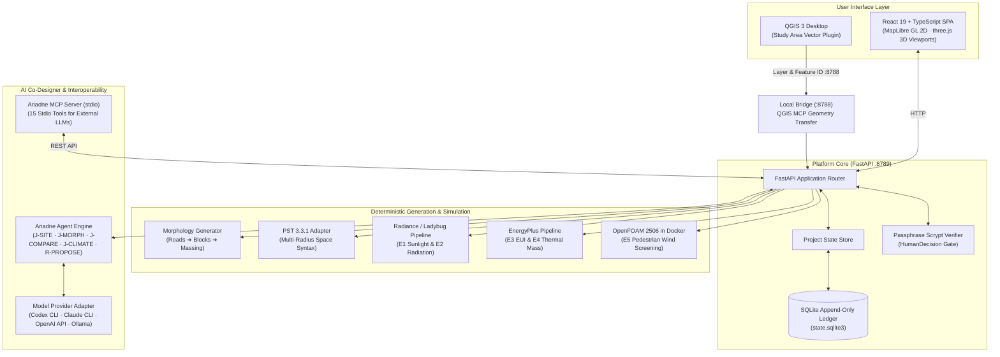
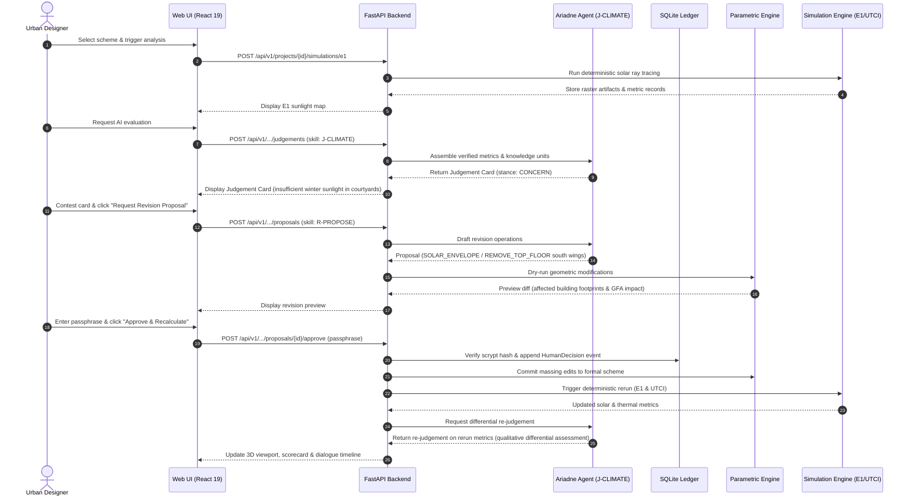

# System Architecture & Technical Specifications

This document outlines the architecture, data models, generation pipelines, and simulation subsystems of **Ariadne**.

---

## 1. System Overview & Component Boundaries

Ariadne follows a strict layered separation of concerns between user interface, authoritative domain backend, deterministic solvers, and AI reasoning modules:



---

## 2. Authoritative State & The HumanDecision Model

A foundational axiom of Ariadne is that **the web frontend, QGIS canvas, and AI conversations do not hold authoritative state**. Workspace state and `HumanDecision` records use `.urban_design_runtime/state.sqlite3`. Judgement, response, and proposal history is stored in the separate `ariadne-judgements.sqlite3` database beside the project database.

> [!NOTE]
> **QGIS, Bridge & API Boundaries**: QGIS sends the selected layer ID and feature ID to the local bridge on `127.0.0.1:8788`; the bridge reads and validates the selected geometry through QGIS MCP. The platform API defaults to `127.0.0.1:8789`, while the QGIS plugin’s upstream API URL defaults to `127.0.0.1:8795`; configure `URBAN_DESIGN_API_BASE_URL` to match the API in use.

### 2.1 The Append-Only Design Ledger
All structural changes to the project are persisted as immutable events in the append-only ledger (`LedgerEvent`):
- `event_id`: Unique prefixed identifier string (e.g., `evt-...`).
- `sequence`: Monotonically increasing integer commit index.
- `timestamp`: ISO-8601 UTC timestamp.
- `actor`: Actor identifier string.
- `actor_kind`: Explicit actor attribution (`HUMAN_UI`, `QGIS_PLUGIN`, `AGENT_AUTOMATION`, `TEST_HARNESS`).
- `action`: Categorical action name (e.g., `STUDY_AREA_CONFIRMED`, `CONSTRAINT_ACTIVATED`, `SCHEME_ADOPTED`, `PROPOSAL_APPLIED`).
- `target_id`: Identifier of modified target entity.
- `target_type`: Target entity type.
- `project_id`: Project identifier (e.g., `rotterdam-m4h`).
- `payload`: Canonical mapping/JSON payload containing entity properties or cryptographic artifact hashes.
- Revision/reference fields: `prior_status`, `changed_refs`, `reason`, `resulting_refs`, `supersedes`, `parent_event_id`, and `state_revision`.

### 2.2 The HumanDecision Passphrase Gate
Consequential design commitments cannot be made by the AI or silently applied by UI scripts. They require an explicit `HumanDecision` record sealed by the designer's personal passphrase:

1. **Passphrase Storage**: During platform initialization (`python -m urban_design.decision_key init`), the designer creates a passphrase (12–4096 characters). The system hashes the passphrase using `scrypt` ($N=16384, r=8, p=1$) and writes it to `~/.config/urban-design/decision-key` with strict `0600` POSIX permissions.
2. **Verification**: When confirming a boundary, activating design constraints, adopting a scheme, or approving a revision proposal, the designer enters their passphrase in the UI. The backend verifies the hash using constant-time comparison (`hmac.compare_digest`).
3. **Immutability**: Once an action is approved as a `HumanDecision`, it becomes part of the permanent ledger. A designer may override an earlier decision by appending a new decision event, but past events are never modified or purged.

---

## 3. Morphological Generation Pipeline

The generation pipeline translates design constraints and urban fabric strategies into topological road networks, parcel blocks, and 3D massing:

```
┌────────────────────────┐
│ Design Constraints     │ (FAR bounds, max heights, setback rules, retained buildings)
└───────────┬────────────┘
            │
            ▼
┌────────────────────────┐
│ Road Network Synthesis │ (Hierarchical primary, secondary & access streets;
│                        │  topological snap to perimeter access nodes)
└───────────┬────────────┘
            │
            ▼
┌────────────────────────┐
│ Block Parcelation      │ (Polygon planar graph decomposition;
│                        │  road right-of-way setbacks; courtyard interior voids)
└───────────┬────────────┘
            │
            ▼
┌────────────────────────┐
│ Building Typology      │ (Floor step allocation: ground 4.0 m, upper 3.5 m;
│ & Massing Extrusion    │  typology grammar: linear bars, closed perimeters,
│                        │  courtyard wings, or freestanding pavilions)
└───────────┬────────────┘
            │
            ▼
┌────────────────────────┐
│ Deterministic Checks   │ (FAR cap verification, daylight envelope checks,
│                        │  waterfront corridor clearance)
└────────────────────────┘
```

### The Four Urban Fabrics
1. **Harbour grain (`harbour_grain`)**: Linear massing perpendicular to the port basin, prioritizing deep maritime view corridors, waterfront air exchange, and longitudinal quayside promenades.
2. **Closed block extension (`closed_block_extension`)**: Traditional European perimeter blocks with continuous street walls, active ground floors, and sheltered private/semi-private interior courtyards.
3. **Courtyard islands (`courtyard_islands`)**: Porous perimeter clusters grouped around central green open spaces, balancing street connectivity with communal courtyard exposure.
4. **Landscape figure (`landscape_figure`)**: Pavilion and finger massing set within an expansive public landscape matrix, minimizing building footprints and maximizing permeable ground area.

---

## 4. Simulation & Environmental Pipelines

Ariadne couples morphological forms with five exploratory simulation pipelines:

### 4.1 Space Syntax (PST 3.3.1)
- **Engine**: Place Syntax Tool (PST 3.3.1) from Chalmers University of Technology, pinned to Python 3.12.
- **Metrics**: Normalised Angular Integration (NAIN) and Normalised Angular Choice (NACH) calculated across three radii:
  - **800 m**: Pedestrian walking accessibility.
  - **2,000 m**: Micro-mobility / cycling catchment.
  - **10,000 m**: Macro vehicular and transit integration.
- **Safety Disclaimer**: Space syntax reflects topological potential within the street graph; it does **not** equal empirical pedestrian footfall or vehicular volume.

### 4.2 E1 Sunlight Hours
- **Engine**: Radiance-compatible deterministic solar ray tracing.
- **Metrics**: Direct sunlight hours on ground surfaces at three critical solar dates:
  - **Winter Solstice (Dec 21)**: Shadow penetration and minimum solar access.
  - **Equinox (Mar 21 / Sep 21)**: Balanced seasonal baseline.
  - **Summer Solstice (Jun 21)**: Maximum solar exposure and shading requirements.

### 4.3 UTCI Heat Stress
- **Engine**: Outdoor Universal Thermal Climate Index (UTCI) model coupled with Dutch KNMI summer weather extremes.
- **Metrics**: Spatial distribution of thermal stress at peak afternoon solar intensity (14:00 on the design summer day), classified into standard comfort categories (No Thermal Stress, Moderate Heat Stress, Strong Heat Stress).

### 4.4 E2 Incident Solar Radiation
- **Engine**: Pinned Ladybug/Radiance cumulative sky model.
- **Metrics**: Total cumulative solar irradiation ($kWh/m^2$) received by building facades, roofs, and ground surfaces across the summer cooling season (May–September). Identifies solar harvesting opportunities and overheating risk hotspots.

### 4.5 E3/E4 Building Energy & Thermal Mass
- **Engine**: EnergyPlus ideal loads simulation.
- **Metrics**:
  - **E3 Energy Use Intensity (EUI)**: Annual heating, cooling, and lighting energy demand per square metre ($kWh/m^2 \cdot a$).
  - **E4 Thermal Mass Performance**: Differential evaluation of heavy-mass masonry/concrete vs. lightweight timber structures in dampening peak cooling loads and mitigating summer overheating hours.

### 4.6 E5 Pedestrian Wind Screening (OpenFOAM in Docker)
- **Engine**: OpenFOAM 2506 executed inside a containerized Docker Desktop runtime (`opencfd/openfoam-run:2506`).
- **Setup**: Inflow boundary conditions derived from Rotterdam weather distributions across four prevailing wind directions (SW, W, S, NW).
- **Disclaimer**: Exploratory screening with a capped coarse mesh (~380,000 cells) for rapid turnaround within a 1.5 GB memory limit. Discloses trend-level shelter vs. acceleration zones; not a substitute for research-grade boundary layer wind tunnel or high-density LES models.

---

## 5. Interaction Sequence: Judgement, Contest, and Revision

The following sequence diagram illustrates the lifecycle of an AI judgement, designer contestation, parametric revision proposal, and recalculation:


