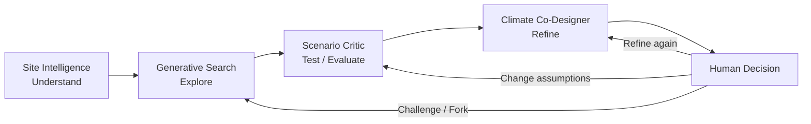
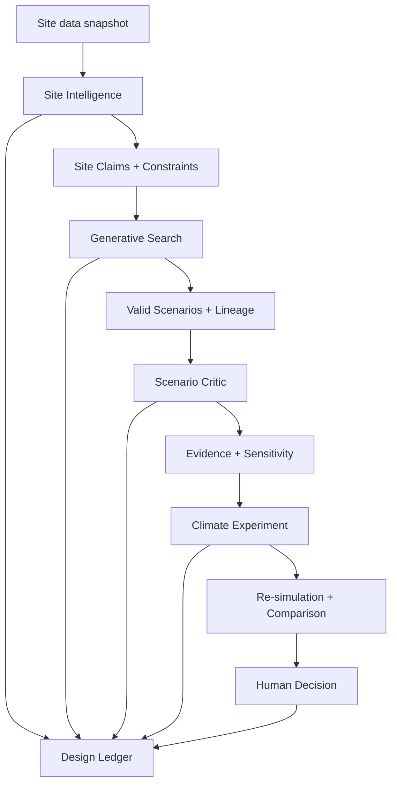
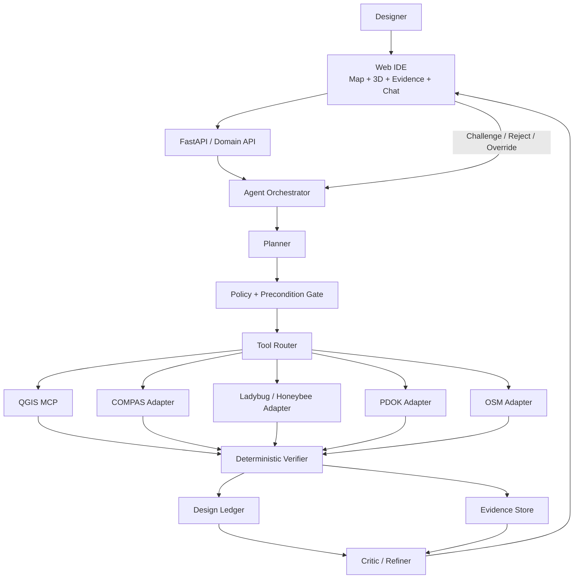

# Evidence-Based、Contestable AI Urban Design IDE：可執行研究與實作報告

## 執行摘要

本研究建議將專案定位為一個 **Evidence-Based, Contestable AI Urban Design IDE**，而不是「AI 自動設計城市」或「把 QGIS、Ladybug、COMPAS 包進聊天介面」。核心研究命題應是：

> **如何讓 AI Agent 在都市設計流程中協調資料、幾何生成、空間分析與環境模擬，同時使每個結論都可追溯、可重現、可挑戰、可修改並可由設計者推翻？**

這個定位與 TU Delft 的 Contestable AI 研究高度吻合：Alfrink 等人將 contestability 視為不只提供 explanation，而是讓相關人能在 AI 系統生命週期中介入、質疑及影響結果；其框架特別強調 safeguards、human control、decision-subject controls 與 third-party scrutiny。TU Delft 後續研究也進一步把 contestability 描述為 AI 系統對人類介入保持開放、並讓受影響者實際影響輸出的能力。citeturn1search14turn1search11 NIST AI Risk Management Framework 同樣把 valid/reliable、accountable/transparent、explainable/interpretable 等列為 trustworthy AI 的核心特徵。citeturn0search8

本專案因此不應把「AI confidence = 0.92」當作可信度，而應建立四層可信度：

```text
Provenance
資料、模型、參數從哪裡來？
      ↓
Reproducibility
同樣輸入與版本能不能重跑？
      ↓
Robustness
換 assumption / parameter，結論還成立嗎？
      ↓
Contestability
不同意時，能否 Inspect → Challenge → Modify → Rerun → Override？
```

產品流程則維持目前已經收斂得很好的四階段：



**八週版本應刻意縮小分析範圍，但不要縮小可信度設計。** 建議只做荷蘭案例；Site Intelligence 以 PDOK、OSM、QGIS 為核心；Generative Search 只做三至五種明確 urban morphology operators；Scenario Critic 固定四組主要指標；Climate Co-Designer 第一版只優化 **solar / incident radiation**，不要同時加入完整 CFD、energy、UTCI、daylight、noise。PDOK 已提供 BAG 與 3D Basisvoorziening 等官方 OGC 服務；OSM Overpass 適合針對道路、POI 與 tags 做選擇性查詢；QGIS 有完整 PyQGIS、Processing 與 network-analysis 能力。citeturn4search0turn4search1turn4search3turn3search1turn17search1

生成層不需要 Rhino 或 Grasshopper 才能成立。COMPAS 核心是純 Python computational framework，可在任何支援 Python 的環境中使用；Rhino、Grasshopper、Blender 是額外 integrations。citeturn20view0 環境層則可直接使用 Honeybee-Radiance CLI/Python；其官方 repository 明確提供 daylight/radiation simulation，不需要 Grasshopper 才能執行。citeturn20view1

整個研究最重要的輸出不是五張 AI 生成的漂亮圖，而是以下可驗證鏈：

```text
Design Claim
    ↓
Metric Definition
    ↓
Assumptions
    ↓
Input Dataset + Version
    ↓
Tool + Parameters + Version
    ↓
Result Artifact
    ↓
Sensitivity Analysis
    ↓
Human Decision
    ↓
Challenge / Override History
```

這個鏈應由一個結構化 **Design Ledger** 保存，而不是只存在 chat history。其資料模型可直接借用 W3C PROV 的 Entity–Activity–Agent provenance 概念，再以 RO-Crate 類型的研究物件包裝方式輸出整個實驗。W3C PROV 專門描述 entities、activities、agents 及其 provenance 關係；RO-Crate 則提供以 JSON-LD/schema.org 為基礎的輕量研究資料與 provenance 包裝方式。citeturn13search0turn13search1

**本研究建議的 MVP 成功標準不是「AI 找到最佳城市」。** 成功標準應是：

> 給定固定基地與固定資料快照，系統能建立可驗證的 Site Model；生成多個 constraint-valid scenarios；以 deterministic tools 計算指標；讓 Agent 只根據 evidence 做 scenario critique；讓使用者挑戰 metric assumptions 並重跑；再對一個選定方案執行一輪 controlled climate-design experiment；最後可以由 Design Ledger 完整重建「怎麼得到這個設計、為什麼得到這個結論、誰接受或否決了它」。

八週若能做到這件事，專案已足以成為一個強的研究 prototype；它同時具有產品、computational design、GIS、environmental simulation 與 responsible/contestable AI 的交叉研究價值。

**本報告的未指定假設。** 以下實作預設 pilot 位於荷蘭、主案例位於 Delft；實際基地 polygon 尚未指定，應在第二週前 freeze。前端預設 Web-based，不依賴 Revit/Rhino/GH；LLM provider 不固定，可使用 OpenAI、Anthropic 或 local model；benchmark 所有資料必須 snapshot，不直接以 live API 作為最終學術實驗輸入。Climate MVP 僅驗證 solar/radiation；UTCI、CFD、energy、Revit/Rhino connectors 均列為後續工作。

## 研究定位與可信度框架

專案真正有研究價值的地方，是把 **Agent autonomy 與 design accountability 放在同一個 architecture 裡**。如果只讓模型自動呼叫 QGIS、COMPAS 和 Ladybug，它很容易淪為「AI glue」；但若 Agent 每次做決策時都必須產生 machine-readable plan、evidence、assumptions、tool trace 與 human-contestation state，則研究對象變成一種新的 **contestable computational design workflow**。這與 TU Delft Contestable AI by Design 所強調的「系統不只是可解釋，而必須提供實際介入、糾正、override 與 scrutiny 機制」一致。citeturn1search14turn1search11

建議正式研究問題寫成：

> **How can an agentic urban-design environment orchestrate site analysis, design-space exploration, scenario evaluation and iterative environmental refinement while preserving provenance, reproducibility, robustness and human contestability?**

下面四個 operational research questions 可以直接變成論文章節與 benchmark：

| 研究問題 | 要證明的事 | 主要量測 |
|---|---|---|
| Site Intelligence | Agent 是否能建立可靠、完整、可追溯的 site model？ | correctness、completeness、time、source traceability |
| Generative Search | Agentic search 是否真的擴大 design space，而非產生相似 geometry？ | constraint satisfaction、diversity、coverage、Pareto quality |
| Scenario Critic | Agent 的設計判斷是否真正建立在 deterministic evidence 上，而且對 assumptions 的敏感性透明？ | claim accuracy、evidence linkage、rank stability、sensitivity |
| Climate Co-Designer | Agent 的修改是否能以 controlled experiment 證明改善目標，而不是任意改造？ | performance delta、constraint preservation、convergence、experiment reproducibility |

研究結果不能以「LLM 的答案看起來合理」作為驗證。計算結果應盡量由 deterministic/geometric/simulation tools 得到；LLM 負責 planning、tool selection、hypothesis generation、trade-off interpretation 與 narrative synthesis。這個分工也符合 NIST 對 trustworthy system 的核心精神：可信度需要系統層級的 validity、reliability、transparency 和 accountability，而不能只依賴模型的自然語言解釋。citeturn0search8

**研究中的 evidence hierarchy 建議如下：**

| 等級 | Evidence 類型 | 例子 | Agent 可否自行推翻 |
|---|---|---|---|
| A | Deterministic / verified computation | FAR、geometry validity、network distance | 不可，除非重新計算 |
| B | Validated simulation output | Radiance radiation result | 不可，只能改模型/參數重跑 |
| C | Derived analytical interpretation | 「B 的 local accessibility 高於 A」 | 可以 challenge assumptions |
| D | Design hypothesis | 「加寬 courtyard 可能改善夏季 radiation」 | 必須實驗驗證 |
| E | Normative judgement | 「B 是比較好的都市方案」 | 永遠由人決定 |

因此 Scenario Critic 不應輸出：

> Scenario B is the best design.

而應輸出：

> Under the stated pedestrian-network definition, destination set and 800 m catchment, Scenario B has higher measured accessibility than A; under the 400 m catchment, the ordering changes. No overall design preference is inferred without an explicit human weighting or decision criterion.

這個語言規範是重要的研究設計，因為建成環境的多目標問題通常包含互相衝突的目標；NSGA-II 本身就是以 non-dominated sorting 處理 multi-objective trade-offs，而不是把所有問題假裝成單一客觀 optimum。citeturn21search3

對「walkability」也必須採同樣態度。Frank 等人的 SMARTRAQ 研究發現 land-use mix、residential density、intersection density 等客觀 urban-form measures 與中度身體活動呈正向關聯；Ewing 與 Cervero 的 built-environment/travel meta-analysis 則顯示 destination accessibility、street-network design 等維度與 travel behaviour 具有系統性的關係。這支持把 density、diversity、connectivity、destination accessibility 拆開量測，但不支持把任意加權的一個分數宣稱為普遍有效的「Walkability Truth」。citeturn21search0turn21search1

因此研究上最好採：

```text
Do not:
Walkability Score = 82/100 → therefore good

Do:
Destination accessibility = X
Intersection density = Y
Land-use entropy = Z
Network reach = R
Assumptions = ...
Sensitivity = ...
```

Space Syntax 也應作為 **可選的 analytical lens，而不是絕對真理**。Hillier 與 Iida 的工作比較了 urban movement 中 topological、angular、metric representations；UCL 的 depthmapX 及相關研究則將這些概念實作為 spatial-network analysis。citeturn21search2 因此 MVP 可把 angular segment integration / choice 放在 stretch goal，並將 radius 視為 contested parameter，而不是預設某一半徑就是「正確尺度」。

最終可信度不應用一個 opaque `confidence = 0.87` 表示，而可以讓系統顯示：

```text
Evidence completeness:     4/4 required evidence items present
Tool verification:         PASS
Input provenance:          PASS
Sensitivity tested:        YES
Conclusion stable:         PARTIAL
Human review:              NOT YET REVIEWED
```

這比讓 LLM 自行報 confidence 更可驗證，也更接近 provenance、reproducibility、robustness 與 contestability 的研究目標。W3C PROV 對 provenance 的標準化 entity/activity/agent 模型提供了可直接借用的語彙基礎。citeturn13search0

## 四階段方法、指標與驗證

**Site Intelligence — Understand**

第一階段回答的不是「AI 覺得這個地方如何」，而是：

> **What can be established about this site from identifiable data and reproducible analysis?**

荷蘭是很適合做此研究的 testing ground。PDOK 提供 BAG 等官方 datasets 與 OGC services；3D Basisvoorziening 結合包括 BGT、BAG、AHN 等來源提供 3D spatial information，官方 API 可查詢 3D collections。citeturn4search0turn4search1turn4search3 OSM 則透過 Overpass API 提供依位置、tags 與 object type 查詢道路、amenities 等 community-maintained geodata 的能力。citeturn3search1

MVP 建議把 Site Model 分成五類，而不是企圖「理解全部城市」。

| 類別 | MVP 指標 | 來源 / 方法 | 研究地位 |
|---|---|---|---|
| Built form | footprint、height、site coverage、FAR proxy | PDOK/BAG/3D + geometry | 核心 |
| Network | street length、intersection density、pedestrian graph | OSM + QGIS | 核心 |
| Accessibility | shortest-path distance to selected amenities | OSM/QGIS | 核心 |
| Land-use / destination | POI counts、categories、entropy | OSM | 核心 |
| Green | park/green polygon area、network access | OSM/PDOK available layers | 核心 |
| Space syntax | angular integration / choice | cleaned street network/depthmapX | optional |

PyQGIS 官方文件提供 vector/raster layer 操作、geometry、CRS transformation、Processing、network analysis 及 standalone Python application 等能力，因此 Stage 1 的數值分析不必由 LLM 實作。citeturn17search1turn17search3

對 accessibility，推薦將 pedestrian network 建成 weighted graph，edge cost 先採 metric length；destination accessibility 定義為從 sample/origin points 沿 network 到指定 POI 的 shortest-path reachability。**400 m、800 m、1200 m 在本研究中應被明確寫成 sensitivity test values，而不是宣稱其為 universally valid walking thresholds。** Ewing/Cervero 與 Frank 等研究支持 accessibility、street connectivity、density 與 land-use mix 作為 relevant built-environment variables，但並不提供一個對所有城市、族群、目的都唯一正確的 catchment distance。citeturn21search0turn21search1

土地混合程度可使用 normalized entropy，例如對 \(K\) 類目的地：

\[
H=-\frac{\sum_{k=1}^{K}p_k\ln p_k}{\ln K}
\]

但這個指標只能表示分類分布的多樣性，不能自行推論「mixed-use quality」。因此 Evidence Card 必須記錄 POI taxonomy、哪些類別被排除、是否將每個 POI 等權處理。

Site Intelligence 的 reproducible benchmark 建議使用三個固定 site polygons，但只需一個作完整四階段 demo。三個 site 應代表不同 urban context；實際位置目前尚未指定，因此在正式研究開始時需要 pre-register polygon、面積與選擇理由。所有 PDOK 與 OSM 原始 response 都寫入 `/data/raw/<snapshot-date>/`，並保存 response body、request URL/query、retrieval timestamp 與 SHA-256 hash。OSM 資料屬開放授權資料，產品輸出與資料再發布也必須保留適當 attribution。citeturn23search0

Stage 1 benchmark：

```text
Frozen Site Polygon
      ↓
PDOK + OSM snapshots
      ↓
ETL
      ↓
Machine-readable Site Model
      ↓
Automated metrics
      ↓
Independent manual/reference calculation
      ↓
Error analysis + provenance audit
```

驗證項目應包括 geometry feature count、area、height availability、road count、POI category count、network node/edge count，以及至少 20 個人工抽樣 object 的 attribute correctness。對可精確比對的連續量，用 absolute/relative error；對 object detection/selection 可用 precision/recall；對 polygon 可用 overlap/IoU；對分析時間可與手動 workflow 做 paired comparison。若有多個 expert 對 semantic categories 進行標註，可額外報告 inter-rater agreement。這些統計方法屬本研究建議，而不是聲稱由上述 urban-design papers 規定。

**Stage 1 failure modes 與 contestable assumptions：**

| 失敗模式 | 為什麼危險 | Mitigation |
|---|---|---|
| CRS/unit 錯誤 | 800「m」可能實際以 degree 運算 | 每個 geometry tool 前強制 CRS/unit validator |
| OSM 缺失或 tags 不一致 | absence of data ≠ absence of place | 顯示 data coverage，不能把 missing 當 zero |
| PDOK/OSM 更新時間不同 | context temporal mismatch | 每個 layer 顯示 timestamp/version |
| POI taxonomy 任意 | accessibility 結果受分類影響 | taxonomy 設定檔 versioned + challengeable |
| Site boundary 不確定 | FAR/coverage 都會改變 | boundary 本身是 Evidence Entity |
| Agent 自行概括 | 「good access」可能沒有量化依據 | 每個 claim 強制 evidence IDs |

**Generative Search — Explore**

第二階段不是讓 LLM 直接吐 vertices，而是把 design space 顯式化：

\[
x=
[
\text{typology},
\text{orientation},
\text{block depth},
\text{courtyard width},
\text{height},
\text{opening width},
\text{setback}, \ldots
]
\]

COMPAS 很適合當 geometry engine，因為其核心 library 是 Python-based computational framework，且可獨立於 Rhino、Grasshopper、Blender 使用；主 library 採 MIT license。citeturn20view0

第一版只推薦實作少量、設計意義明確的 operators：

```text
create_perimeter_block()
create_linear_blocks()
create_cluster()
split_block()
open_block_edge()
rotate_mass()
change_height_distribution()
move_building()
resize_courtyard()
```

每個 scenario 必須保留完整 lineage：

```text
Scenario C.3
├── Parent: C.2
├── Generator: perimeter_block@0.3.1
├── Seed: 231194
├── Site Model: site_v1.2
├── Constraints:
│   ├── FAR 2.1–2.3
│   ├── max_height ≤ 24 m
│   └── min_open_space ≥ 0.35
├── Mutation:
│   └── courtyard_width 18 → 22 m
└── Reason:
    "test increased courtyard openness"
```

搜尋策略不宜一開始直接使用「AI 自己想」。應至少保留一個 uniform/random baseline，再與 multi-objective search 比較。NSGA-II 是經典 non-dominated sorting multi-objective evolutionary algorithm；其目的正是維持多個 non-dominated solutions，而非只回傳一個單一 optimum。citeturn21search3 若研究重點更偏「產生大量 qualitatively different 高品質方案」，MAP-Elites/quality-diversity 類方法則明確以維持不同 behavioural niches 中的高性能解為目標，因此是很適合的第二階段研究 extension。citeturn8search5 Generative urban design 的既有研究也已將 energy 與 financial/urban-layout goals 放入自動化 neighborhood layout exploration，顯示這類 multi-objective design-space search 在 urban scale 具有研究先例。citeturn8search26

八週 MVP 不建議同時完整實作 NSGA-II 與 MAP-Elites。建議：

```text
Baseline:
Random sampling

Research search:
NSGA-II

Stretch:
MAP-Elites
```

生成品質至少測以下五件事：

| 指標 | 定義 |
|---|---|
| Constraint Satisfaction Rate | 符合全部 hard constraints 的 candidates / all candidates |
| Geometry Validity Rate | 無 self-intersection、無 site overflow 等錯誤比例 |
| Design Diversity | normalized parameter/feature-space pairwise distances |
| Objective Coverage | 不同 objective 區域是否都有方案 |
| Pareto Hypervolume | multi-objective non-dominated set 的覆蓋表現 |

為避免「20 個 scenario 只是同一個 courtyard 大小不同」，應額外建立 **morphology descriptor**，例如 block count、built/open ratio、orientation distribution、perimeter continuity、number of public passages、height variance。這些 descriptors 用於 diversity analysis，而不是直接評價方案好壞。

實驗建議在同一 frozen Site Model 上，使用相同 evaluation budget，比較 Random 與 NSGA-II。例如每個方法 30 個 random seeds、每 seed 200 evaluations；若 computational cost 太高，可先降至 20 seeds 並明確報告限制。對 repeated runs 可報 median、IQR、bootstrap confidence intervals；多個 algorithm/site 的 paired comparison 可採 Friedman test，再以 paired Wilcoxon + Holm correction 做 post-hoc。這是建議的研究設計，正式論文若要做 confirmatory statistical claims，應先依 pilot variance 做 power analysis。

**Stage 2 最重要的 contestability：**

使用者可以問：

> Why does this scenario exist?

系統不是回答一段 LLM prose，而是打開 genealogy：

```text
Source constraint
      ↓
Generator operator
      ↓
Parameter values
      ↓
Mutation
      ↓
Constraint validation
      ↓
Objective results
      ↓
Agent rationale
```

被淘汰的 scenarios 不刪除，只標記：

```text
REJECTED
Reason: max_height constraint
Evidence: constraint_run_431
```

這對研究很重要，因為 selection bias 本身也成為可檢視對象。

**Scenario Critic — Test / Evaluate**

這一階段應是整個系統最嚴謹的地方。Agent **不能自己算結果，也不能沒有 evidence 就下設計結論。**

推薦 MVP 固定四個 dimensions：

| Dimension | Metric | Tool |
|---|---|---|
| Development intensity | FAR、site coverage | geometry/Python |
| Pedestrian accessibility | network reach / POI accessibility | QGIS |
| Urban structure | intersection density、land-use entropy | QGIS/Python |
| Environmental | solar/radiation | Ladybug/Honeybee |

可選第五項才是 Space Syntax angular integration/choice。Hillier 與 Iida 對 angular、metric 與 topological route representations 的研究提供理論依據，但具體 radius 仍應視研究問題與 urban scale 而定。citeturn21search2

每個 Scenario Critic claim 應符合：

```json
{
  "claim_id": "claim_0042",
  "statement": "Scenario B has greater 800 m amenity accessibility than A.",
  "claim_type": "comparative",
  "evidence_ids": ["metric_A_acc800", "metric_B_acc800"],
  "assumption_ids": ["assumption_poi_weights_equal", "assumption_radius_800"],
  "result": {
    "scenario_A": 0.67,
    "scenario_B": 0.79,
    "difference_pp": 12
  },
  "scope": "selected amenity taxonomy only",
  "human_status": "unreviewed"
}
```

這種 schema 可以直接阻止：

> “Scenario B is more human-friendly.”

因為沒有工具輸出能支持「human-friendly」這個更高層 normative claim。

最重要的功能不是 **Explain**，而是 **Challenge this conclusion**。

假設 B 在 800 m accessibility 高於 A：

```text
Challenge:
"What happens if the catchment is 400 m?"
```

系統重跑：

| Scenario | 400 m | 800 m | 1200 m |
|---|---:|---:|---:|
| A | 61% | 67% | 83% |
| B | 58% | 79% | 91% |

這時系統應說：

> B 的優勢不具有 scale invariance；在目前 400 m definition 下排序反轉。

而不是繼續維護原本的 AI 結論。

更完整的 sensitivity layer 可以採 SALib；官方文件支援 Morris、Sobol、FAST 等 global sensitivity methods。citeturn9search2 建議策略是：parameter 很多或 simulation 昂貴時先做 Morris screening，再對少量重要參數跑 Sobol；這是本專案的 computational-budget 建議，而不是普遍規範。

Scenario Critic 的 sensitivity parameters 至少包含：

```text
walking_radius = [400, 800, 1200]
poi_weight_scheme = [equal, category_weighted]
network_filter = [strict_pedestrian, permissive]
green_access_radius = [...]
metric_normalization = [...]
```

排名 robustness 可以計算各 sensitivity run 之間的 Kendall rank correlation；但更重要的是 UI 直接呈現「誰在什麼 assumption 下贏」。若 scenario objectives 衝突，產品應呈現 Pareto front，而不是偷偷使用一組不可見 weights。

學術驗證應分成兩層。第一層測 **computation correctness**：固定 synthetic fixtures，例如一個 1 km square grid、已知面積 polygon、已知 shortest path，讓工具結果與手算/reference implementation 一致。第二層測 **Agent claim correctness**：給 Agent 一組 evidence bundle，逐一檢查每個自然語言 claim 是否能追溯到正確 evidence IDs、是否超出 evidence scope、是否混淆 percentage 與 percentage points。這可以做成 automated eval corpus。

**Climate Co-Designer — Refine**

第四階段的研究語言最好不要是：

> AI optimizes the design.

而是：

> **AI proposes and executes controlled computational design experiments.**

Honeybee-Radiance 官方 repository 專門提供 Radiance daylight/radiation simulation，並提供 CLI；Ladybug Tools 本身則建立於 Radiance、EnergyPlus/OpenStudio 等 simulation engines 之上。citeturn20view1turn23search4

MVP 可以建立兩層 climate analysis：

| 層級 | 用途 | 方法 | 優點 / 限制 |
|---|---|---|---|
| Fast Screening | 大量 candidate 排除 | Ladybug cumulative sky + Incident Radiation | 快，但官方文件明確說 Incident Radiation 元件不模擬 solar reflections，而 ground reflection 只是近似。citeturn10search1turn10search5 |
| Verification | selected scenarios | Honeybee-Radiance | 更適合正式 Radiance-based verification。citeturn20view1 |

Ladybug Cumulative Sky Matrix 使用 Radiance `gendaymtx` 建立天空 patch radiation matrix；Incident Radiation 產生 cumulative incident radiation，以 `kWh/m²` 等單位表示。citeturn10search1turn10search5

對 Honeybee-Radiance，simulation settings 不能藏起來。官方 command documentation 顯示 `rfluxmtx` 包含 ambient divisions (`-ad`)、ambient resolution (`-ar`)、ambient super-samples (`-as`) 等參數；例如目前文件中的 command defaults 包含 `ad=1024`、`ar=256`、`as=512`。citeturn11search3 這些應被視為**起始參數而非「業界最佳值」**。本研究應自己做 convergence study。

建議 project-specific convergence protocol：

```text
Run A: ad = 1024
Run B: ad = 2048
Run C: ad = 4096
```

其他 recipe、geometry、weather、sensor grid、materials 固定；`as` 可維持與 `ad` 一致的預先設定比例，完整 Radiance command 必須寫入 Ledger。研究自己的 acceptance criterion 可以暫定為最高兩層 settings 之間，主要 aggregate metric 改變 <2%、P95 grid result 改變 <5%；**這是本專案預先註冊的 convergence threshold，不是 Radiance 官方標準。**

Sensor grid 同樣要做 sensitivity，而不是假裝 2 m spacing 天然正確。MVP 可定義：

```text
public realm horizontal sensor grid
height: 0.1 m above modeled surface
candidate spacing: 1 m / 2 m / 4 m
primary MVP spacing: 2 m
```

然後比較 1/2/4 m 對 scenario ordering 的影響。上述數值是本研究的 computational-budget setting，不是通用規範。

Climate Co-Designer 不應一次改十個東西。它應建立：

```text
Observation
    ↓
Hypothesis
    ↓
Controlled Intervention
    ↓
Simulation
    ↓
Comparison
    ↓
Constraint check
    ↓
Accept / Reject / Fork
```

例如：

```text
Observation:
Scenario C summer public-realm radiation is high
in western courtyard.

Hypothesis:
Increasing courtyard width while redistributing
height can reduce selected radiation metric
without decreasing FAR.

Control:
Scenario C.3

Independent variable:
courtyard_width = [18, 20, 22, 24]

Locked:
site boundary
street network
programme
FAR tolerance
weather file
radiance settings
sensor grid

Dependent variables:
median radiation
P90 radiation
high-exposure area fraction
```

結論只能是：

> 22 m performed best **within the tested range and current metric definition**.

而不能寫：

> 22 m is the optimal courtyard.

若日後加入 outdoor thermal comfort，UTCI 可以作為候選指標；UTCI 的 operational procedure 是基於人體熱生理反應、並使用 air temperature、radiation、humidity、wind 等氣象條件建立 equivalent temperature。citeturn12search6 但八週版本不建議同時把 UTCI、CFD、vegetation、material albedo 全部納入，否則驗證成本會迅速超過 project scope。

四階段最終的 credibility 不是逐階段獨立，而是連成完整 chain：



## 可爭議性、證據模型與 Design Ledger

Contestability 應該是產品 architecture，而不是最後多一個「Why？」按鈕。TU Delft 的 Contestable AI by Design 框架強調的正是 safeguards、interactive controls、decision-subject interventions 與 external scrutiny；因此你的 UI 應提供真正能改變 computational state 的操作，而非只有 explanation。citeturn1search14turn1search11

每個 Agent output 至少具備七個動作：

| Action | 實際作用 |
|---|---|
| Inspect | 查看 source、parameter、tool、artifact |
| Challenge | 宣告「我質疑這個 assumption / claim」 |
| Modify | 修改 radius、weight、constraint 或 design parameter |
| Rerun | 以新設定重算 |
| Fork | 從當前 evidence/design state 建立 branch |
| Reject | 拒絕 Agent proposal |
| Override | 人類輸入取代 Agent decision，並記錄理由 |

這裡最重要的是 **Challenge 必須產生 state transition**。只讓使用者寫「我不同意」而計算結果完全不改，不算完整 contestability。

Design Ledger 建議採 append-only event model。不要讓 Agent 修改舊 event；任何修正都是新 event：

```text
event_001  Site imported
event_002  PDOK snapshot created
event_003  OSM snapshot created
event_004  Accessibility@800m calculated
event_005  Agent claim created
event_006  Human challenged radius
event_007  Accessibility@400m calculated
event_008  Original claim superseded
event_009  Scenario C generated
...
```

W3C PROV 將 provenance 表示為 Entity、Activity、Agent 等關係，因此可以自然映射：dataset/scenario/result 是 Entity，simulation/tool run 是 Activity，人或 LLM/tool service 是 Agent。citeturn13search0 最後可將完整 run 封裝成 RO-Crate，將 research data、metadata 和 provenance 一起保存。citeturn13search1

建議的核心資料模型：

| Entity | 必要欄位 |
|---|---|
| `Artifact` | id, type, uri, sha256, mime, crs, created_at |
| `DataSnapshot` | source, query, retrieved_at, license, raw_artifact |
| `ToolRun` | tool, version, params, inputs, outputs, exit_status |
| `ModelRun` | provider, model_id, prompt_hash, schema_version, response_hash |
| `Assumption` | text, scope, source, status |
| `MetricDefinition` | formula, unit, parameters, implementation_version |
| `Claim` | statement, evidence_ids, assumption_ids, scope |
| `DesignScenario` | parent, geometry_hash, parameters, constraints |
| `ContestEvent` | target_id, action, user_reason, resulting_event |
| `HumanDecision` | accepted/rejected/modified/override, author, reason |

其中一個完整 Evidence Record 可以長這樣：

```json
{
  "schema_version": "0.1.0",
  "claim": {
    "id": "claim_0042",
    "type": "comparative",
    "text": "Scenario B has higher 800 m amenity accessibility than Scenario A."
  },
  "evidence": [
    {
      "metric_id": "accessibility_selected_poi",
      "scenario": "A",
      "value": 0.67,
      "unit": "fraction"
    },
    {
      "metric_id": "accessibility_selected_poi",
      "scenario": "B",
      "value": 0.79,
      "unit": "fraction"
    }
  ],
  "assumptions": [
    "pedestrian_network_policy@1.0",
    "poi_taxonomy@1.2",
    "catchment_800m"
  ],
  "tool_run": {
    "tool": "qgis.accessibility",
    "tool_version": "0.4.2",
    "qgis_version": "pinned",
    "crs": "EPSG:<project-crs>",
    "input_hashes": ["sha256:...", "sha256:..."],
    "parameters": {
      "radius_m": 800
    }
  },
  "sensitivity": {
    "tested": true,
    "variants": [400, 800, 1200]
  },
  "human_review": {
    "status": "challenged",
    "reason": "800 m catchment may hide local accessibility."
  }
}
```

`ModelRun` 不應保存 private chain-of-thought；保存的是可供 audit 的 prompt/template version、structured request、tool decisions、final structured output 與 relevant rationale summary。這樣可重現 system behaviour，同時避免把不可控的模型內部 reasoning 當成 evidence。

Design Ledger 也需要觀測 agent runtime。OpenTelemetry 是 vendor-neutral 的 traces、metrics、logs observability framework，因此可用 trace/span IDs 把一個 Agent request、MCP call、QGIS run、simulation 與 Ledger events 串起來。citeturn13search3 建議：

```text
trace_id
 ├── planner span
 ├── qgis_tool span
 ├── verifier span
 ├── critic span
 └── ledger_commit span
```

但 tracing 與 provenance 要分開：OpenTelemetry 用來 debug runtime；Design Ledger 才是學術與設計決策 provenance。

最重要的 contested assumptions register 應該直接成為 UI 頁面：

| Assumption | Default | 可挑戰？ | Challenge 後動作 |
|---|---|---:|---|
| pedestrian catchment | 800 m | 是 | rerun 400/1200 |
| POI weighting | equal | 是 | recompute |
| street filtering | configured pedestrian policy | 是 | rebuild graph |
| max height | user/project constraint | 是 | regenerate |
| FAR target | user/project constraint | 是 | regenerate |
| solar grid spacing | 2 m MVP default | 是 | rerun 1/4 m |
| simulation recipe | pinned | 是 | rerun verification |
| objective weights | none by default | 是 | user explicitly supplies |

這最後一項非常重要：**系統預設不應該偷偷做加權總分。**

跨階段的失敗模式可以整理成：

| Failure | Detection | Mitigation |
|---|---|---|
| LLM hallucinated metric | Claim references nonexistent evidence ID | schema rejects output |
| Tool call 錯 layer | input semantic/type check | typed artifact contracts |
| CRS mismatch | precondition validator | refuse execution |
| Unit mismatch | unit schema | fail closed |
| Prompt injection from dataset labels | treat data strings as untrusted data | no instructions accepted from tool payload |
| Tool execution succeeded but result wrong | invariants/reference tests | verifier |
| Live API changed | snapshot/hash mismatch | frozen data |
| Model provider changed | model/run metadata | provider-specific regression eval |
| Metric gaming | cross-metric checks | Pareto/trade-off display |
| User override disappears | append-only Ledger | never mutate previous decision |
| Agent silently retries destructive step | tool permission policy | idempotency + human approval |
| Simulation settings drift | recipe hash/version | settings locked per experiment |

這種 approach 比單純「human in the loop」更強，因為人不是只有最後批准，而是能改變 assumptions、重新計算、fork design lineage，並留下可供第三方審查的歷史。這正是 contestability 研究所要求的實質介入，而不是 cosmetic explanation。citeturn1search14turn1search11

## 技術架構、Agent 編排與工具介面

建議的系統不是 multi-agent swarm，而是 **controlled agentic state machine**。自由自治越高，reproducibility 越差；因此八週研究版最好是一個 orchestrator 加 typed tools，再把 Planner、Critic、Refiner 視為不同角色/prompt，而非獨立自由 Agent。



**Planner** 只產生 plan，不計算結果：

```json
{
  "goal": "compare pedestrian accessibility of A and B",
  "steps": [
    {
      "id": "s1",
      "tool": "urban.build_pedestrian_graph",
      "inputs": ["osm_snapshot_2026_..."],
      "approval": "auto",
      "expected_output_type": "PedestrianGraph"
    },
    {
      "id": "s2",
      "tool": "urban.accessibility",
      "depends_on": ["s1"],
      "params": {"radius_m": 800}
    }
  ],
  "assumptions": ["assumption_radius_800"],
  "success_criteria": ["metric bundle validates"]
}
```

**Tool Router** 不直接相信模型傳入任何 arguments。每個 tool 都有 JSON Schema/Pydantic validation、allowed units、input artifact types、resource limits 與 permission class。

**Verifier** 是整個 architecture 最重要、也最不應依賴 LLM 的部分。它負責：

```text
schema validity
CRS validity
unit validity
geometry validity
expected file existence
NaN / Inf checks
range/invariant checks
artifact hashes
tool exit status
constraint checks
```

LLM verifier 可以額外檢查「自然語言 claim 是否超出 evidence」，但 numeric correctness 不交給 LLM。

**Memory** 分四種，而不是全部塞進聊天 context：

```text
Working Memory
當前 request / plan

Project State
site / constraints / scenarios

Evidence Memory
metrics / simulations / artifacts

Design Ledger
immutable history
```

這樣即使更換 LLM provider，也不會失去 project truth。

MCP 可作為 tool interface；目前官方 MCP 文件已發展成通用的 tools/resources/prompts communication protocol，且官方 Python SDK 支援現行 specification。citeturn14search1turn14search7 但 MCP 官方 reference servers 自身也警告它們主要用於展示協議能力，而非直接視為 production-ready secure infrastructure，因此本專案仍需要自己的 allowlist、authentication、permission 和 validation layer。citeturn14search5

**QGIS adapter**

目前 `nkarasiak/qgis-mcp` 已在 QGIS 官方 plugin repository 出現，repository 現有 118 個 MCP tools，涵蓋 layer、feature、processing、rendering、layouts、SQL 等；其 architecture 是 MCP server 經 socket 與 QGIS plugin/PyQGIS 互動。citeturn18search1turn19view0 Repo 同時暴露 `execute_code` 類能力，而且 README 明確指出預設 local socket 並不等同 sandbox；其 plugin 與 MCP server 分別採 GPLv2+ 與 MIT license。citeturn20view2

因此不要讓 Agent 直接看到全部 118 tools。建立自己的高階 allowlist：

```text
urban.get_project_info
urban.validate_crs
urban.load_snapshot
urban.calculate_far
urban.build_pedestrian_graph
urban.destination_accessibility
urban.intersection_density
urban.landuse_entropy
urban.green_access
urban.render_evidence_map
```

除 developer/debug profile 外，預設 **禁止 `execute_code`**。

**COMPAS adapter**

COMPAS core 可以純 Python 執行，且官方 repo 說明它不依賴 Rhino/GH/Blender 才能工作。citeturn20view0 不需要等外部 MCP；你的 repository 自己包成：

```text
compas.generate_typology
compas.mutate_parameter
compas.open_block
compas.redistribute_height
compas.validate_geometry
compas.compute_area_metrics
compas.export_scenario
```

每次 tool call 必須輸入 `parent_scenario_id` 與 `seed`，並回傳 geometry artifact hash。

**Ladybug/Honeybee adapter**

Honeybee-Radiance 已有 Python package 與 CLI，因此 custom MCP wrapper 只需要處理 recipe preparation、filesystem、settings、execution、result parsing。citeturn20view1

```text
climate.make_sensor_grid
climate.screen_incident_radiation
climate.run_radiance
climate.compare_runs
climate.convergence_check
```

所有 climate tool output 都要包含 weather-file hash、geometry hash、sensor-grid hash 與 simulation settings。

**PDOK adapter**

```text
pdok.fetch_bag
pdok.fetch_3d_context
pdok.fetch_bgt
pdok.snapshot
```

PDOK 的 BAG 與 3D Basisvoorziening 均已有官方 API/OGC interface，因此 adapter 重點不是重新實作 GIS protocol，而是 cache、schema normalization、snapshot 和 provenance。citeturn4search0turn4search1turn4search3

**OSM adapter**

```text
osm.fetch_overpass
osm.extract_poi
osm.extract_walkable_network
osm.snapshot
```

Overpass API 本身是針對 OSM database 做選擇性查詢的介面。citeturn3search1 Benchmark 不應每次 live query，而應把 raw Overpass result freeze；若公開展示 derived OSM data，也要保存 OSM attribution。citeturn23search0

**LLM adapter**

LLM 不應是 architecture dependency，而是一個 interface：

```python
class LLMAdapter:
    def create_plan(...) -> Plan: ...
    def create_claims(...) -> ClaimSet: ...
    def propose_experiment(...) -> ExperimentPlan: ...
    def summarize_tradeoffs(...) -> DesignReview: ...
```

第一版至少支援：

| Provider 類型 | 優勢 | 缺點 | 建議用途 |
|---|---|---|---|
| Cloud reasoning model | tool use / reasoning 通常較容易整合 | API 成本、vendor dependence | 主研究 run |
| Cloud low-cost model | 低成本、低 latency | complex planning 可能較弱 | summarization/classification |
| Local model | privacy、無 per-call API charge | hardware 與 model capability 依設備變動 | offline/privacy experiment |

OpenAI API 的 Structured Outputs 可以用 developer-provided JSON Schema 約束輸出，`strict` structured tool definitions 可用於 function/tool workflows，這很適合本系統的 `Plan`、`ClaimSet` 和 `ExperimentPlan`。citeturn16search0 Anthropic 現行 API 文件也提供 tool use 與 structured outputs 等 agent-building surfaces。citeturn15search0 因此 domain layer 不應綁任何 provider-specific message type，而應統一轉成內部 Pydantic schemas。

建議 Planner prompt：

```text
SYSTEM

You are an orchestration planner for a contestable urban-design system.

You do NOT calculate GIS, geometry, environmental, or statistical values.
You may only request registered tools.

Every planned analytical claim must identify:
1. required evidence,
2. assumptions,
3. tool,
4. parameters,
5. verification step.

Never call a normative design option "best" unless the user explicitly
supplies a decision rule.

If required data are missing, return MISSING_EVIDENCE instead of guessing.

Return only the Plan schema.
```

Scenario Critic：

```text
SYSTEM

You are an evidence-constrained urban design critic.

Use only supplied EvidenceRecords.

Every claim MUST contain:
- evidence_ids
- assumption_ids
- scope
- uncertainty_or_limitation

Distinguish:
OBSERVATION
COMPARISON
INFERENCE
NORMATIVE_JUDGEMENT

Do not transform correlation into causation.
Do not invent metrics.
Do not hide conflicting evidence.
```

Climate Refiner：

```text
SYSTEM

You design computational experiments, not final designs.

Propose the smallest interpretable intervention that tests the stated
hypothesis.

Specify:
- control scenario
- changed variables
- locked variables
- evaluation metric
- expected direction
- stopping rule

Do not claim improvement until the simulation result has been verified.
```

Error recovery 必須分開 technical error 與 semantic error：

```text
Network timeout
→ retry with exponential backoff

Idempotent tool crash
→ retry limited times

CRS mismatch
→ DO NOT retry
→ return validation failure

Constraint violation
→ DO NOT hide
→ record failed candidate

Simulation non-convergence
→ record run as invalid
→ adjust settings only via explicit new experiment

LLM malformed schema
→ schema repair/retry

LLM unsupported claim
→ verifier rejects claim
→ ask model to regenerate from existing evidence only
```

Repository 建議：

```text
urban-design-ide/
├── README.md
├── AGENT.md
├── CONTRIBUTING.md
├── LICENSES.md
├── pyproject.toml
├── package-lock.json
│
├── apps/
│   ├── web/
│   └── api/
│
├── core/
│   ├── domain/
│   ├── orchestration/
│   ├── verification/
│   ├── ledger/
│   └── evidence/
│
├── adapters/
│   ├── qgis/
│   ├── pdok/
│   ├── osm/
│   ├── compas/
│   ├── ladybug/
│   └── llm/
│       ├── openai/
│       ├── anthropic/
│       └── local/
│
├── schemas/
│   ├── plan.schema.json
│   ├── evidence.schema.json
│   ├── claim.schema.json
│   ├── experiment.schema.json
│   └── ledger.schema.json
│
├── experiments/
│   ├── site_intelligence/
│   ├── generative_search/
│   ├── scenario_critic/
│   └── climate_refinement/
│
├── data/
│   ├── raw/
│   ├── snapshots/
│   ├── fixtures/
│   └── derived/
│
├── tests/
│   ├── unit/
│   ├── integration/
│   ├── regression/
│   └── research/
│
└── docs/
    ├── architecture.md
    ├── methodology.md
    ├── metrics.md
    ├── provenance.md
    ├── contestability.md
    ├── api.md
    ├── demo.md
    └── research-protocol.md
```

`README.md` 應說明問題、四階段 workflow、30 秒 quickstart、demo GIF、architecture、research claims 與「系統不宣稱自動產生最佳都市設計」。`AGENT.md` 應定義 deterministic-vs-LLM boundary、tool permissions、evidence requirement、禁止事項、schema contracts。`CONTRIBUTING.md` 應要求新增 metric 必須附公式、unit、reference、test fixture 與 sensitivity parameters。`docs/api.md` 或 `openapi.yaml` 應描述 project/scenario/evidence/challenge endpoints。`LICENSES.md` 非常重要，因為 QGIS 是 GPLv2+，QGIS MCP plugin/server 有 GPL/MIT component split，COMPAS core 是 MIT，而 Honeybee-Radiance repository 採 AGPL-3.0；正式散布前應避免無意將不同授權程式碼直接 copy 到不相容 package。citeturn23search3turn20view2turn20view0turn20view1

主要技術選擇可以總結如下：

| Component | Performance | Reproducibility | 軟體/API成本 | 關鍵 trade-off |
|---|---|---|---|---|
| PDOK OGC | 高度依網路 | snapshot 後高 | 官方開放資料服務為主 | Netherlands-specific data model。citeturn4search0turn4search3 |
| OSM Overpass | 查詢視 bbox 複雜度而定 | snapshot 後高 | 公開開放資料基礎設施 | completeness/tagging varies。citeturn3search1turn23search0 |
| QGIS/PyQGIS | 適合 GIS batch/processing | 高，若 inputs/version 固定 | Free/open source GPLv2+ | Desktop process/integration complexity。citeturn17search1turn23search3 |
| QGIS MCP | Agent integration 快 | 需 pin repo/plugin/version | Open-source | tool surface 大、需 security gate。citeturn19view0turn20view2 |
| COMPAS | Geometry 操作通常輕量 | seed/params 固定時高 | MIT/open source | urban-design semantics 需自己定義。citeturn20view0 |
| Ladybug Incident Radiation | 適合快速 screening | settings 固定時高 | open ecosystem | 不應把無 reflections 的簡化結果當 full physical model。citeturn10search5 |
| Honeybee-Radiance | 比 screen simulation 重 | 高，若 recipe/version/data fixed | AGPL package/open-source stack | simulation settings 需 convergence study。citeturn20view1turn11search3 |
| Cloud LLM | latency/provider dependent | prose 不應要求 bitwise reproducibility | usage-based | capability 強但 vendor/model drift |
| Local LLM | hardware dependent | model weights/version可固定 | 無 per-call cloud API 費 | integration/capability 需自測 |

## 八週執行、測試與示範

八週的策略應是：**每一週都增加可驗證能力，而不是到第八週才補 research validity。**

| 週次 | 核心工作 | Deliverable | Exit criteria |
|---|---|---|---|
| Week A | Domain schemas、Ledger、project state、LLM adapter skeleton | `Plan`, `Evidence`, `Claim`, `LedgerEvent` schemas | event replay test PASS |
| Week B | PDOK/OSM snapshots + QGIS safe adapter | frozen pilot data | identical snapshot hashes on rerun |
| Week C | Site Intelligence metrics + validation | site evidence dashboard | reference-fixture tests PASS |
| Week D | COMPAS generation + constraint engine | 3–5 morphology families | validity + constraint tests PASS |
| Week E | Scenario Critic + sensitivity layer | evidence-based comparison UI | unsupported claim rate target reached |
| Week F | Ladybug/Honeybee climate experiment | one end-to-end refinement loop | reproducible radiation experiment |
| Week G | Contestability UX + provider swapping + research benchmark | Inspect/Challenge/Fork/Override | ledger captures all actions |
| Week H | freeze、evaluation、documentation、demo | GitHub release candidate + report | clean-machine demo reproducible |

**Week A** 不應先做 fancy UI，而要先做 data contracts。建立 `Project`, `Scenario`, `Artifact`, `ToolRun`, `EvidenceRecord`, `Claim`, `Assumption`, `ContestEvent`。所有後續 stage 只能透過這些 schemas 溝通。LLM provider 在第一週就做 adapter interface，避免八週後 architecture 綁死一個 API。OpenAI Structured Outputs 或其他 provider 的 structured tool interfaces可用於實作 provider-specific adapter，但內部 schema保持不變。citeturn16search0turn15search0

**Week B** 選定三個 benchmark polygons，至少一個作完整 demo。將 BAG/3D/OSM 等 response freeze；建立 CRS validator。QGIS MCP 可以直接重用現有 plugin/server，但只 expose 自己的 allow-listed tool facade。現有 QGIS MCP repository 的大量低階 tools 與 arbitrary code capability正是為何需要這層 facade。citeturn19view0turn20view2

**Week C** 完成 built-form、network、amenity-accessibility、land-use、green metrics。Site Intelligence 的每一個 dashboard value 都可以點到 input data、formula、tool run。Frank 等研究支持將 land-use mix、residential density、intersection density 等視作 walkability-related urban-form variables；Ewing/Cervero 的 meta-analysis支持 destination accessibility/network design 等構面，因此這一組比創造一個 opaque AI score 更有實證基礎。citeturn21search0turn21search1

**Week D** 只做可控 geometry operators。先生成 30–100 candidates、constraint-filter，再呈現 5 個代表 solutions。研究 benchmark 比 Random 與 NSGA-II；NSGA-II 的 non-dominated sorting 特別適合不想預先把所有 urban objectives 壓成單一 weighted score 的情境。citeturn21search3

**Week E** 建立 Critic。Agent 不再拿 raw GIS data，而只拿 validated Evidence Bundle。實作 `Challenge assumption`，至少支援 walking radius 400/800/1200 與 POI weighting 的重新計算。加入 Morris/Sobol interface 可以先只跑 small research test；SALib 已提供相應 sensitivity-analysis implementation。citeturn9search2

**Week F** 固定 climate scope 為 radiation。先以 Ladybug Incident Radiation screening，再對 selected candidates 用 Honeybee-Radiance。前者對 reflections 的限制必須在 UI 顯示，後者則執行已記錄 settings 的 Radiance workflow。citeturn10search5turn20view1 完成一個可重播的 controlled intervention：例如 courtyard width 或 height redistribution。

**Week G** 才做真正 contestable UI：

```text
Evidence Card
[ Inspect ]
[ Challenge ]
[ Change Assumption ]
[ Rerun ]
[ Fork ]
[ Reject ]
[ Override ]
```

並跑 LLM provider regression：相同 evidence bundle 分別送入至少兩個 adapters，確認兩者都遵守相同 structured schema。這不是要求文字相同，而是檢查 evidence citation completeness、unsupported-claim rate、tool-plan validity。

**Week H** freeze dependencies、data、prompts、models/configs、simulation recipes，重新跑完整 benchmark。GitHub release 必須能在 clean environment 上重建至少一個完整案例。

最低自動測試集合：

| Test ID | Case | Expected |
|---|---|---|
| `GEO-001` | EPSG:4326 layer 要直接做 metric buffer | BLOCK |
| `GEO-002` | known 100×100 m parcel | area = reference |
| `NET-001` | synthetic graph shortest path | equals reference |
| `NET-002` | 400/800/1200 rerun | distinct versioned results |
| `GEN-001` | generated block outside site | INVALID |
| `GEN-002` | height > max | REJECTED + ledger event |
| `GEN-003` | same seed/config | identical geometry hash |
| `EVD-001` | claim missing evidence ID | schema FAIL |
| `EVD-002` | claim references wrong scenario | verifier FAIL |
| `EVD-003` | “best” without decision rule | critic-policy FAIL |
| `CLM-001` | different weather hash | comparison BLOCK |
| `CLM-002` | different sensor grid unnoticed | comparison BLOCK |
| `CLM-003` | refinement reduces target metric but violates FAR lock | REJECT |
| `LED-001` | replay scenario history | geometry/state reproduced |
| `LED-002` | override prior AI decision | both original + override retained |
| `SEC-001` | LLM requests raw QGIS `execute_code` | DENY |
| `LLM-001` | provider returns malformed JSON | controlled retry |
| `LLM-002` | provider invents evidence ID | verifier rejects |

學術 evaluation 建議分成四組实验。

**Site experiment：** Agent workflow 對 manual/reference workflow。主要 outcome 為 factual correctness、completeness、processing time、provenance completeness。Manual reference 由研究者與至少一位 second reviewer adjudicate；若要對人類評價做正式 inferential claims，participant number 不應直接拍腦袋設定，應依 pilot effect size/power analysis 決定。

**Generative experiment：** Random vs NSGA-II，在相同 evaluation budget 與多個 seeds 下比較 constraint satisfaction、validity、diversity 與 hypervolume。NSGA-II 的論文提供方法基礎；若之後要把 novelty/diversity 提升為主研究問題，可以加入 MAP-Elites。citeturn21search3turn8search5

**Critic experiment：** 建立例如 50–100 個 known evidence bundles，其中故意包含 ranking reversal、missing data、conflicting metrics、percentage/percentage-point traps。測 `evidence-link precision`、`unsupported claim rate`、`scope violation rate` 與 challenge 後能否正確修正 conclusion。

**Refinement experiment：** 使用固定 scenario、weather、geometry baseline、simulation recipe 與 controlled parameter sweep。主要報告 effect size、constraints preserved/violated、convergence sensitivity；不要因為單一 run 提升 12% 就推論 universal design principle。

一個完整 demo 應控制在大約 8–12 分鐘，而不是現場跑幾百次 optimization。

```text
Demo opening
“Here is a fixed site in Delft.”

        ↓

Understand
Load frozen PDOK + OSM snapshot.
Click building/accessibility claim.
Show source + hash + calculation.

        ↓

Explore
“Generate alternatives around FAR 2.2,
minimum open-space ratio 35%.”
Show candidate lineage and invalid candidates.

        ↓

Test
Compare five selected scenarios.
Show accessibility / density / urban structure / radiation.

        ↓

Contest
Click:
“Why is B considered more accessible?”

Show 800 m evidence.

Click:
“Challenge 800 m.”

Rerun 400 / 800 / 1200.
Show that conclusion may or may not remain stable.

        ↓

Refine
Select Scenario C.
Agent proposes:
“test courtyard width 18/20/22/24 m.”

COMPAS creates variants.
Honeybee/Ladybug evaluates.

        ↓

Human decision
Designer rejects or accepts one alternative.

        ↓

Ledger
Open complete provenance graph:
data → scenario → metric → claim → challenge
→ experiment → human decision.

        ↓

Export
Research bundle / ledger / scenario artifacts.
```

這個 demo 最強的 moment 其實不會是「AI 生了五個城市」，而會是：

> **AI 說 B 比較好 → 你按 Challenge → 系統改 assumption、重新計算，甚至推翻自己原本的結論，而且整個過程完整保留。**

這一刻才真正展示了它不是 chatbot、也不只是 automation，而是 **contestable computational design environment**。

八週正式 scope 建議凍結如下：

| 必做 | 不做 / 延後 |
|---|---|
| PDOK + OSM snapshot | 全球資料 adapters |
| QGIS evidence analysis | 完整 Space Syntax suite |
| 3–5 COMPAS generators | AI 任意 free-form geometry |
| Random + NSGA-II | 完整 MAP-Elites UI |
| FAR/accessibility/mix/green | 十幾個 urban KPIs |
| Solar/radiation | CFD |
| One controlled refinement | full climate optimization |
| Design Ledger | enterprise collaboration |
| Inspect/Challenge/Rerun/Fork | multi-user permissions |
| cloud/local LLM adapters | fine-tuning |
| Web UI | Revit integration |
| export geometry/data | Rhino/GH live sync |

Rhino/GH/Revit connector 都可以後續做；這並不影響研究 prototype 的核心成立。COMPAS 本身可在純 Python 環境中使用，而 Honeybee-Radiance 亦提供 Python/CLI workflow，因此核心系統可以保持 CAD-platform-independent。citeturn20view0turn20view1

最後的 go/no-go criteria 建議設定為：

```text
GO if:

≥ 95% deterministic fixture tests pass
100% displayed claims contain evidence IDs
0 critical CRS/unit errors escape verifier
all design variants retain lineage
all climate comparisons have matching recipe/weather/grid hashes
user can challenge and rerun at least 3 assumptions
ledger replay reconstructs selected scenario
one complete 4-stage case runs end-to-end

Research success:
demonstrate not that AI designs better cities,
but that AI-supported urban-design reasoning
can be made inspectable, reproducible,
sensitivity-aware and contestable.
```

## 證據附錄

以下列出本報告最主要的 academic、standard、official documentation 與 repository sources。URL/DOI 為直接 implementation 與研究追蹤使用；軟體版本在正式 benchmark 時仍需寫入 lockfile 與 Design Ledger，因為目前文件與 repositories 會持續更新。

| 類別 | 來源 | 用途 | DOI / URL |
|---|---|---|---|
| Contestable AI | Alfrink, K., Keller, I., Kortuem, G. & Doorn, N., *Contestable AI by Design: Towards a Framework*, Minds and Machines | contestability framework、human intervention、scrutiny | `https://doi.org/10.1007/s11023-022-09611-z` citeturn1search14 |
| Contestable AI | TU Delft, *Understanding Decision Subjects’ Needs and Perceptions Towards Contestable AI Systems* | decision-subject contestability / intervention | TU Delft Research Portal citeturn1search11 |
| Trustworthy AI | NIST AI Risk Management Framework / AIRC | valid/reliable、transparent、accountable、explainable AI | `https://www.nist.gov/itl/ai-risk-management-framework` citeturn0search8 |
| Provenance | W3C PROV | Entity–Activity–Agent provenance model | `https://www.w3.org/TR/prov-o/`；`https://www.w3.org/TR/prov-dm/` citeturn13search0 |
| Reproducibility | RO-Crate | research-object/data/provenance packaging | `https://www.researchobject.org/ro-crate/` citeturn13search1 |
| Observability | OpenTelemetry | traces、metrics、logs | `https://opentelemetry.io/docs/` citeturn13search3 |
| Site data | PDOK BAG | official Dutch built-environment OGC data | `https://api.pdok.nl/kadaster/bag/ogc/v2/api?f=html` citeturn4search0turn4search2 |
| 3D data | PDOK 3D Basisvoorziening | BAG/BGT/AHN-based 3D context | `https://api.pdok.nl/kadaster/3d-basisvoorziening/ogc/v1?f=html&lang=en` citeturn4search1turn4search3 |
| OSM | OpenStreetMap Overpass API | roads、POI、tag-based spatial queries | `https://wiki.openstreetmap.org/wiki/Overpass_API` citeturn3search1 |
| OSM licensing | OpenStreetMap copyright/licence | attribution / open-data requirements | `https://www.openstreetmap.org/copyright` citeturn23search0 |
| GIS | QGIS PyQGIS Developer Cookbook | vector/raster、CRS、Processing、network analysis | `https://docs.qgis.org/latest/en/docs/pyqgis_developer_cookbook/` citeturn17search1 |
| GIS Agent | QGIS MCP | existing QGIS MCP server/plugin/tool surface | `https://github.com/nkarasiak/qgis-mcp` citeturn19view0turn20view2 |
| QGIS licence | QGIS Project | GPLv2+ | `https://qgis.org/` citeturn23search3 |
| Computational geometry | COMPAS | Python computational geometry/AEC framework | `https://github.com/compas-dev/compas` citeturn20view0 |
| Environmental simulation | Honeybee-Radiance | Radiance daylight/radiation Python/CLI extension | `https://github.com/ladybug-tools/honeybee-radiance` citeturn20view1 |
| Environmental workflow | Ladybug Tools | Radiance/EnergyPlus/OpenStudio-based environmental ecosystem | `https://www.ladybug.tools/` citeturn23search4 |
| Radiation | Ladybug Cumulative Sky Matrix | `gendaymtx`-based sky radiation matrix | Ladybug Tools Primer citeturn10search1 |
| Radiation | Ladybug Incident Radiation | cumulative incident radiation + documented limitations | Ladybug Tools Primer citeturn10search5 |
| Radiance settings | honeybee-radiance `rfluxmtx` documentation | `ad`, `ar`, `as` etc. simulation parameters | Ladybug Tools API documentation citeturn11search3 |
| Thermal comfort | Bröde et al., *Deriving the operational procedure for the Universal Thermal Climate Index* | UTCI methodology | `https://doi.org/10.1007/s00484-011-0454-1` citeturn12search6 |
| Walkability | Frank et al., *Linking objectively measured physical activity with objectively measured urban form* | density、mix、intersection-related empirical evidence | `https://doi.org/10.1016/j.amepre.2004.11.001` citeturn21search0 |
| Built environment | Ewing & Cervero, *Travel and the Built Environment: A Meta-Analysis* | accessibility、network design、travel relationships | `https://doi.org/10.1080/01944361003766766` citeturn21search1 |
| Space Syntax | Hillier & Iida, *Network and Psychological Effects in Urban Movement* | angular/topological/metric network representations | `https://doi.org/10.1007/11556114_30` citeturn21search2turn21search14 |
| Multi-objective search | Deb et al., *A Fast and Elitist Multiobjective Genetic Algorithm: NSGA-II* | Pareto/non-dominated design exploration | `https://doi.org/10.1109/4235.996017` citeturn21search3 |
| Quality-diversity | Mouret & Clune, *Illuminating Search Spaces by Mapping Elites* | diverse high-performing alternatives / MAP-Elites | `https://arxiv.org/abs/1504.04909` citeturn8search5 |
| Generative urban design | Nagy et al., *Generative Urban Design: Integrating Financial and Energy Goals for Automated Neighborhood Layout* | precedent for multi-objective neighborhood generation | Autodesk Research / SimAUD citeturn8search26 |
| Sensitivity analysis | SALib documentation | Morris、Sobol、FAST implementations | `https://salib.readthedocs.io/` citeturn9search2 |
| Tool protocol | Model Context Protocol | current MCP architecture/specification | `https://modelcontextprotocol.io/` citeturn14search1 |
| MCP security caution | MCP reference servers | reference implementations are not by themselves production security architecture | official MCP servers repository citeturn14search5 |
| Structured LLM output | OpenAI, *Structured Outputs in the API* | JSON-Schema-constrained Agent outputs | `https://openai.com/index/introducing-structured-outputs-in-the-api/` citeturn16search0 |
| Alternative LLM adapter | Anthropic API documentation | Messages、tool use、structured outputs | `https://docs.anthropic.com/` citeturn15search0 |

整體而言，現有 open-source ecosystem 已足以支撐這個研究：QGIS/PyQGIS 提供 deterministic GIS；PDOK/OSM 提供 spatial evidence；COMPAS 提供可控 geometry operations；Ladybug/Honeybee/Radiance 提供 environmental simulation；MCP 提供 agent–tool interface；W3C PROV、RO-Crate、NIST 與 TU Delft Contestable AI 則提供 provenance、reproducibility 與 contestability 的治理基礎。citeturn17search1turn4search0turn3search1turn20view0turn20view1turn14search1turn13search0turn13search1turn0search8turn1search14

因此最值得被視為本專案原創貢獻的，不是任何一個底層分析演算法，而是它們之上的 **contestable orchestration protocol**：

```text
UNDERSTAND
data → provenance → site claims

EXPLORE
constraints → generator → lineage

TEST
metrics → evidence → sensitivity → contest

REFINE
hypothesis → controlled intervention
→ simulation → re-validation

DECIDE
human accepts / rejects / modifies / forks

AUDIT
the entire chain remains reproducible
```

如果這條鏈在八週內被可靠地實作與實驗驗證，專案就不再只是「AI 接 QGIS、COMPAS、Ladybug 的 demo」，而是一個具有清楚學術命題與可延伸產品架構的 **Evidence-Based, Contestable AI Urban Design IDE**。