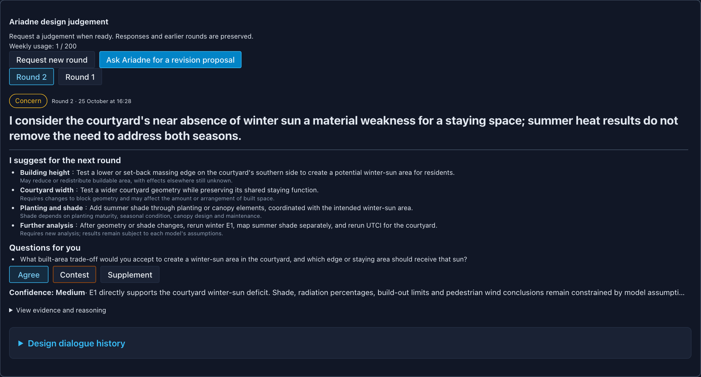

# Ariadne User Guide: Step-by-Step Design Session Walkthrough

This guide walks through a complete end-to-end design session using Ariadne. We will explore the transformation of the **Rotterdam Merwe-Vierhavens (M4H)** harbour district across Ariadne's five workflow tabs.

---

## Workspace Layout & Navigation

The Ariadne interface consists of three primary zones:
1. **Top Stage Ribbon**: Switches between the five design stages (**Site**, **Conditions**, **Generate**, **Compare**, **Refine**), view modes (**2D**, **3D**, **Split**, **Compare**), and language toggle (**EN** / **繁中**).
2. **Central Viewport Canvas**: High-performance MapLibre GL 2D map and three.js 3D spatial viewport with synchronized camera controls.
3. **Collapsible Right Inspector**: Houses the **Ariadne AI Workspace Panel**, design dialogue timeline, scheme scorecards, and the **AI Model Settings** panel.

---

## Stage 1: Site Definition & Baseline Ingestion

### Step 1.1: Draw or Synchronize the Study Area
1. Open QGIS 3 with the **Urban Design Study Area** plugin installed. The plugin provides three actions: **Draw Study Area**, **Use as Study Area**, and **Sync to Platform**.
2. Click **Draw Study Area** to draw your study polygon over the Rotterdam M4H basin (or select an existing polygon layer and click **Use as Study Area**).
3. Click **Sync to Platform** in QGIS. QGIS sends the selected layer ID and feature ID to the local bridge on `127.0.0.1:8788`; the bridge reads and validates the selected geometry through QGIS MCP. The platform API defaults to `127.0.0.1:8789`, while the QGIS plugin’s upstream API URL defaults to `127.0.0.1:8795`; configure `URBAN_DESIGN_API_BASE_URL` to match the API in use.
4. Alternatively, use the **Site** tab toolbar in the web interface and choose **Draw extent** to outline a polygon directly on the MapLibre canvas.

### Step 1.2: Ingest Authoritative Datasets
The API consumes previously prepared, verified local BAG and OSM data from a source package:
- **PDOK BAG (CC0)**: Prepared local official Dutch building footprints.
- **OpenStreetMap (ODbL)**: Prepared existing road axes, dockland quays, and water edges.
Drawing an extent does not trigger data acquisition. Any 3DBAG height join is a separate, source-backed processing step and is not performed by this runtime loader.

### Step 1.3: Inspect Baseline Evidence
Click **Basic Site Analysis** in the ribbon to open the initial diagnosis drawer:
- Review 24 verified baseline claims (`claim-m2-001` through `claim-m2-024`).
- Check baseline land use, water interface length, and existing building density.
- Invoke `J-SITE` from the Ariadne panel to receive an initial heritage and perimeter condition diagnosis.

---

## Stage 2: Conditions & Constraints Setup

### Step 2.1: Heritage & Retained Buildings
In early-stage brownfield transformation, retaining key historical structures anchors identity and reduces embodied carbon:
1. In the central 3D viewport, select existing port structures (e.g., the historic Gusto shipyard warehouse and concrete harbour silos).
2. In the right property inspector, set **Disposition** to `RETAINED`.
3. Retained structures are rendered in dark grey and permanently locked; the generation engine will build around them without alteration.

### Step 2.2: Space Syntax Multi-Radius Analysis
Toggle the **Space Syntax Overlay** in the ribbon:
- View **PST 3.3.1** Normalised Angular Integration (NAIN) and Choice (NACH) across the surrounding urban fabric.
- Inspect the **800 m pedestrian radius** to identify primary walking spines.
- Switch to the **2 km cycling catchment** and **10 km regional vehicular network** to verify how the harbour connects into Rotterdam's western radial arteries.

### Step 2.3: Establish Design Constraints
Constraint set A is derived from the author's earlier studio design and is an assumption, not a verified regulatory envelope: FAR 0.8 (land-area denominator), maximum height 20 m, coverage 0.35, about 40 % open space as a preference, and a 15 m waterfront public band. Enter project-specific constraints from an approved source before describing them as regulatory limits:
- **Maximum FAR**: e.g. 0.8 (constraint set A, assumed from the studio design).
- **Maximum Building Height**: $36.0\text{ m}$ (portfolio baseline target).
- **Coverage Target**: $0.32$.
- **Open Space Ratio Target**: $0.22$.
- **Waterfront Band**: $15.0\text{ m}$ public promenade corridor.

### Step 2.4: Record Review & Approve Constraints with Passphrase
To seal design conditions and review, navigate to the respective panel, click **Record Review** (or approve constraints in the constraints panel), and enter your personal decision passphrase. The backend verifies possession of the local decision passphrase and appends a `HumanDecision` record. This is a passphrase authorization check, not a digital signature or identity proof.

---

## Stage 3: Multi-Fabric Scheme Generation

### Step 3.1: Trigger Morphological Synthesis
1. Navigate to the **Generate** tab.
2. In the **Generation Readiness** panel, verify that all input conditions are marked ready.
3. Select your desired generation mode (e.g., preview or full strategy synthesis) and click **Start**.

### Step 3.2: Inspect the Four Synthesized Schemes
Ariadne queries the urban morphology knowledge base (`knowledge/v2/`) and executes deterministic network-to-massing generators to construct four distinct spatial strategies:
- **Harbour grain (`harbour_grain`)**: Linear finger piers extending toward the water, maximizing south-facing waterfront exposure.
- **Closed block extension (`closed_block_extension`)**: Continuous European perimeter blocks providing clear public street vs. private courtyard hierarchy.
- **Courtyard islands (`courtyard_islands`)**: Porous block clusters organized around sheltered, shared neighborhood courtyards.
- **Landscape figure (`landscape_figure`)**: Pavilion buildings set within an expansive green landscape matrix.

---

## Stage 4: Multi-Scheme Comparison & Environmental Simulation

### Step 4.1: Side-by-Side 2D & 3D Evaluation
1. Switch to the **Compare** tab and select **Split View** or **Quad Compare**.
2. Rotate and zoom: the viewports remain synchronized in coordinate space, allowing direct visual comparison of massing density and street sightlines.
3. Compare summary metrics in the scorecard: Gross Floor Area (GFA), Footprint Area, Floor Area Ratio (FAR), and Waterfront Permeability.

### Step 4.2: Inspect Microclimate Results
Click on the **Climate & Environment** drawer. The Climate Extras drawer displays artifact-backed climate results. E1 and E2 have separate run workflows; the drawer does not launch UTCI, E3/E4, or E5 runs. The bundled E5 screening covers SW, W, S, and NW:
- **E1 Sunlight Hours**: Computes cumulative direct sunlight on ground surfaces for the winter solstice (Dec 21), equinox (Mar 21), and summer solstice (Jun 21) via its dedicated run workflow.
- **UTCI Heat Stress**: Evaluates outdoor heat stress at 14:00 on the design summer day (artifact-backed).
- **E2 Solar Radiation**: Incident facade and roof irradiance ($kWh/m^2$) calculated via its separate workspace.
- **E3/E4 Energy & Mass**: Displays annual EUI and thermal mass buffering artifacts.
- **E5 OpenFOAM Wind Screening**: Displays coarse CFD wind screening artifacts covering four wind sectors (SW, W, S, and NW).

### Step 4.3: Engage with Ariadne Judgement Cards

1. In the right panel, Ariadne issues a **Judgement Card** (e.g., `J-CLIMATE` for *Harbour grain*):
   - **Stance**: `CONCERN`.
   - **Headline**: *"Winter courtyard daylight is constrained by south wing heights in harbour grain massing."*
   - **Evidence Ref**: Cites `e1.harbour.courtyard.winter.mean_h` ($0.108\text{ h}$).
   - **Limitations**: Explicitly states that E5 wind screening is a coarse mesh screening and space syntax reflects potential rather than actual traffic.
2. You have three choices on every card:
   - **Agree**: Concur with Ariadne's assessment.
   - **Contest**: Challenge Ariadne's stance (e.g., arguing that quayside wind shelter outweighs winter solar access).
   - **Supplement**: Add local contextual notes.

### Step 4.4: Request & Apply Revision Proposals
1. If you contest the card, click **Request Revision Proposal**.
2. Ariadne activates `R-PROPOSE` and suggests parametric edits:
   - Operation: `REMOVE_TOP_FLOOR` on the south wings of courtyard blocks.
   - Operation: `RERUN` for E1 Sunlight and UTCI.
   A proposal may describe qualitative expected effects and trade-offs. Report numerical changes only after a successful deterministic rerun, using the resulting metrics. No fixed improvement or GFA loss is guaranteed.
3. Click **Preview Proposal Dry-Run** to inspect affected footprints and proposed operations in the overlay.
4. Click **Approve & Recalculate** and enter your decision passphrase.
5. The platform verifies the passphrase, executes the geometric change, reruns E1 solar ray tracing, and Ariadne issues an updated re-judgement card based on the rerun metrics.

---

## Stage 5: Interactive Massing & Road Refinement

### Step 5.1: Direct Massing Operations
1. Navigate to the **Refine** tab and select a building volume in the 3D canvas (the ribbon displays the summary label).
2. Use keyboard and UI hotkeys to adjust massing:
   - **Floor Up / Down**: Increments height in standard floor steps (ground floor: 4.0 m; upper floors: 3.5 m).
   - **1 m Lateral Move**: Nudge volumes along grid axes.
   - **Face Split & Upper Setback**: Subdivide upper levels to create stepped terraces and daylight envelopes.
3. Observe real-time validator indicators: if an edit exceeds the active constraint set (for example the 20 m height cap), the edit is blocked and the reason is shown.

### Step 5.2: Road Network Alignment
1. Open the scenario editor (`ScenarioStudio`).
2. Use the road-snapping control to drag street vertices and adjust alignment. Vertices automatically snap to existing perimeter connections with topological consistency.

### Step 5.3: Final Scheme Adoption
Once satisfied with the refined scheme:
1. Click **Adopt Scheme as Final**.
2. Enter your decision passphrase.
3. The platform seals the scheme in the append-only ledger, stamping it as the definitive outcome of your design session.

---

## AI Model Configuration

At any point during the session, access the **AI Model Settings** panel by clicking the gear icon in the inspector:
- Choose your active profile (**Codex CLI**, **Claude CLI**, **OpenAI-Compatible API**, or **Ollama**; note that Ollama is shipped as a disabled template and must be configured with an endpoint and model before use).
- Check the live status indicator (`AVAILABLE`, `MISSING_KEY`, etc.).
- Monitor your weekly live AI call budget (default: 200 calls).
